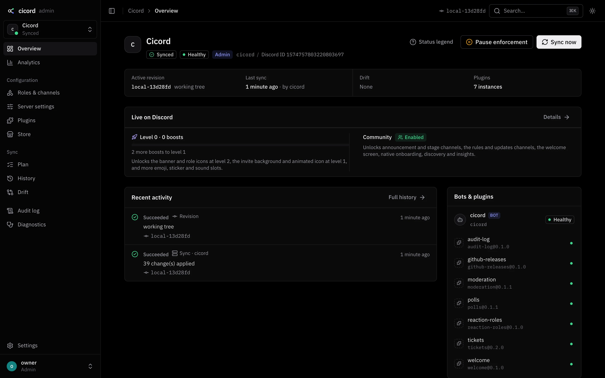

Cicord derives permissions from **Discord itself**: the roles a user has on a server decide
what they can do in the admin console and on the community portal.

## Roles per server

For each server, a user is one of:

| Role        | Who                                                                       | Can                                                                                                                                                                                          |
| ----------- | ------------------------------------------------------------------------- | -------------------------------------------------------------------------------------------------------------------------------------------------------------------------------------------- |
| `admin`     | The server owner (always), and the roles or users in `spec.access.admins` | Everything a moderator can, plus: the plan, syncs, every plugin setting, the Store (install, update, uninstall), plugin secrets, icon, banner and splash uploads, lifting incident overlays, member data export and erasure, and Diagnostics (failed tasks, interop). |
| `moderator` | The roles or users in `spec.access.moderators`                            | The server's overview, analytics, resources, sync history, drift and audit log; [pausing and resuming enforcement](../reconciliation/#emergency-pause-enforcement) (with the pending plan while paused); plugin instances, and the plugin settings marked `x-cicord-access: moderator`; moderator portal routes (tickets, warnings…). |
| `member`    | Any member of the Discord server                                          | The portal (profile, onboarding, member routes).                                                                                                                                             |
| none        | Not in the server                                                         | Public portal pages and `public` plugin routes only.                                                                                                                                         |

```yaml title="servers/my-community.yaml"
spec:
  access:
    admins:
      roles: [admin] # role keys of this server
    moderators:
      roles: [moderator]
      users: ["112233445566778899"] # Discord user IDs
```

The user's live roles are fetched from Discord through the server's bot (cached 30 seconds)
and matched against `spec.access`. Admin wins over moderator.

Changing the plugin sources of the project (adding or removing a registry in `cicord.yaml`)
requires the admin role on **every** server of the project. Updating a plugin requires the
admin role on every server where it runs, since its version is shared.

## Field-level access for plugin settings

Plugin settings pages are generated from each plugin's `config.schema.json`. By default only
admins may edit a field; a plugin author marks the fields moderators may change:

```json
"message": {
  "type": "string",
  "default": "Welcome {member} to {server}!",
  "x-cicord-widget": "textarea",
  "x-cicord-access": "moderator"
}
```

A moderator who edits the base config must be a moderator of every server it applies to.
Every save goes through [write-back](../write-back/): a commit or a pull request, according
to the policies.

## The admin console

The admin console is served at `<public-url>/admin/` (or on its own admin URL when one is
configured) and embedded in the binary. Per server it has: Overview (sync, health, drift),
Analytics, Resources, Server settings (with **Member data**: export, erase, and purge the data
of uninstalled plugins), Plugins with their generated settings pages and secrets, the
**Store**, Plan (with the active incident overlays), History, Drift, Audit and
**Diagnostics** (the setup wizard's checks on demand, failed tasks to retry or discard, and
the interop links between plugins). Pages a moderator cannot use (Store, Plan, Diagnostics)
are hidden for them. It has light and dark themes and a command palette; with
`cicord dev --sim` it also shows the **Simulator** panel.



## Signing in

| Method                                              | Used by                                                             | Scope                                                                                                                                                                                                                                           |
| --------------------------------------------------- | ------------------------------------------------------------------- | ----------------------------------------------------------------------------------------------------------------------------------------------------------------------------------------------------------------------------------------------- |
| **Discord login** (OAuth2, scope `identify`)        | Admin console, portal                                               | The user's roles on every server. Sessions last 7 days.                                                                                                                                                                                         |
| **Portal link** (`ctx.portal.link()` with a member) | A link sent by a plugin, e.g. in a DM                               | One server only, and at most `member` outside the portal endpoints, so a forwarded link never opens the admin console. The link is valid 15 minutes by default, 24 hours at most; the session it opens lasts until the link expires, at least 1 hour. |
| **Case link** (`ctx.portal.link()` with a `scope`)  | An appeal or verification result, e.g. for a banned member          | Discord sign-in as the original recipient, then only the issuing plugin's `scoped` routes for that case. At most 7 days; the plugin can revoke it. See [Case links](../../reference/http-api/authentication/#case-links). |
| **Session token** (token mode)                      | Portals embedded on another origin                                  | Full role on the portal endpoints and plugin routes, at most `member` elsewhere. 24 hours.                                                                                                                                                      |
| **Runtime token** (`CICORD_RUNTIME_TOKEN`)          | CLI and CI (`cicord plan --remote`, `cicord status`, `cicord sync`) | Admin on every server.                                                                                                                                                                                                                          |
| **Dev login**                                       | `cicord dev` only                                                   | Any user; requires `--sim` or the runtime token.                                                                                                                                                                                                |

To enable Discord login, set `CICORD_DISCORD_CLIENT_SECRET` (the OAuth2 client secret of the
application, in the environment or the secret store) and add **`<public-url>/auth/callback`**
to the application's OAuth2 redirect URLs. The client ID defaults to the application ID of the
first bot (by key); `CICORD_DISCORD_CLIENT_ID` overrides it. Without a client secret,
`/auth/login` answers `503`.

Sessions are HttpOnly, `SameSite=Lax` cookies (`Secure` behind HTTPS). Every state-changing
request needs the `X-Cicord-Request` header or an `Authorization` header, and an `Origin` that
is the public URL or an allowed origin. See the [security checklist](../../self-hosting/security/)
and [HTTP API → Authentication](../../reference/http-api/authentication/).
