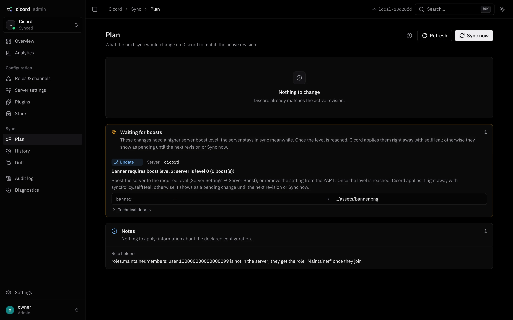
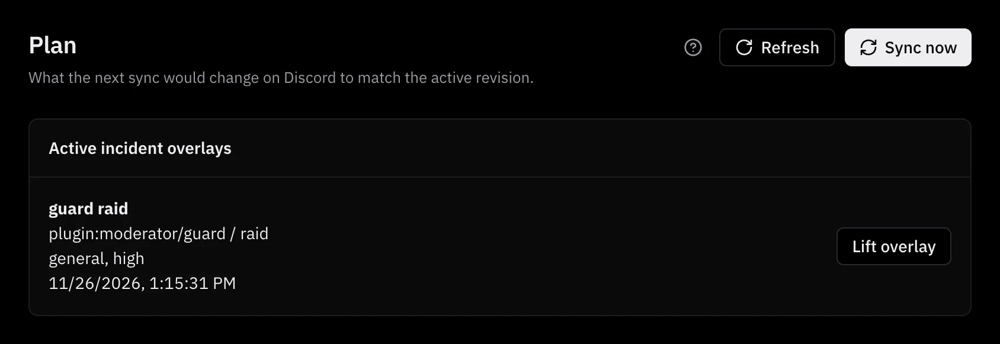
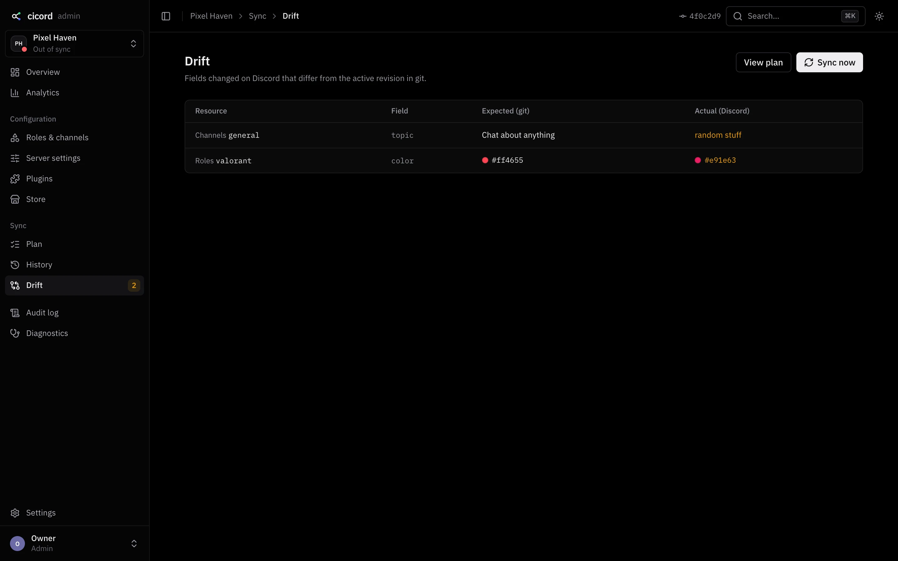

The **server reconciler** turns the YAML of a server into Discord state. It runs inside the
runtime on every new revision, on drift, every 5 minutes (a plan, applied only with
`syncPolicy.selfHeal`), on an explicit sync (**Sync now** in the admin console), and behind
`cicord plan` and `cicord apply` on the command line.

## Plan and apply

A **plan** is the ordered list of changes between the YAML and the live server. Its actions
are `create`, `update`, `delete`, `adopt`, `reorder` and `unmanage`. What Discord would refuse
is listed apart as **blocked**, with a reason, and never fails the plan. **Notes** need no
action (a listed role member who has not joined yet).

**Apply** runs the plan in a fixed order, aware of Discord's rate limits:

1. server basics and `@everyone`;
2. roles (adopt, create, update), role positions, then roles given to their listed `members`;
3. categories, then channels;
4. server channel references and the Community toggle (system, AFK, rules, updates and
   safety alerts channels), then the channels that need Community;
5. channel positions, widget, welcome screen, native onboarding;
6. AutoMod rules, then emojis, stickers and soundboard sounds;
7. deletions (AutoMod, expressions, channels, categories, roles), then `unmanage`.

Apply continues past failures: changes that depend on a failed one fail as `unresolved`, and
the next sync resumes (the next revision or **Sync now**; with `syncPolicy.selfHeal`, also
the periodic sync every 5 minutes). A failure on one server does not block the others. In production the
runtime applies every revision it activates; `cicord apply` is for development and
bootstrapping.



## Lifecycle of a revision

```text
commit ─▶ fetch ─▶ validate ─▶ build ─▶ plan ─▶ apply servers ─▶ activate bots ─▶ report
```

- The **active revision** only changes when validation and the plugin build succeed. A
  rejected revision leaves the previous one running.
- Bots are **hot-swapped**: new plugin VMs start, are validated, then traffic switches per
  bot, without a gateway reconnect. Plugin storage persists across revisions.
- Every activation, rejection and server sync is recorded in the **sync history** (admin
  console, `GET /api/v1/history`).

Each server and bot reports a status, ArgoCD style:

| Sync                             | Health                                          |
| -------------------------------- | ----------------------------------------------- |
| `Synced`, `OutOfSync`, `Unknown` | `Healthy`, `Progressing`, `Degraded`, `Missing` |

## Adoption by name

Pointing Cicord at an existing server does not duplicate it. A declared key without a mapping
**adopts** an unmapped live resource of the same kind (role, category, or channel of the same
type) with exactly the same display name, and updates its differing fields in the same change.

- Text-like channel names are compared after Discord's normalization (lowercase, runs of
  whitespace become `-`): `name: General Chat` matches `#general-chat`.
- AutoMod rules are adopted by name and trigger; a trigger allowed once per server
  (`mentionSpam`, `spam`, `keywordPreset`, `memberProfile`) adopts the existing rule whatever
  its name. Emojis, stickers and sounds are adopted by name.
- A live resource is adopted at most once. Mapped resources, managed roles (bot and
  integration roles) and `@everyone` are never candidates. Keys are processed in key order,
  candidates in Discord ID order.
- Mappings are written as soon as a create succeeds, so a resource created by a crashed apply
  is adopted on the next run. A key whose mapped ID no longer exists in Discord is created
  again.
- A display name change is an `update` (a rename). A key change that keeps the display name
  and kind shows an `adopt` under the new key and an `unmanage` (`move … mapping`) for the old
  one: see [Keys and display names](../repository-layout/#keys-and-display-names).

The setup wizard and `cicord import` rely on this: the first plan after an import is empty.
After losing the state database, `cicord adopt` rebuilds the local resource map by name.

## What Cicord owns

- **Only mapped resources are modified.** Roles, channels and categories that were never
  declared are ignored.
- **Plugin-owned resources** (ticket channels of the `tickets` plugin, for example) belong to
  their plugin instance and are never touched or pruned, even with `prune: true`. A YAML key
  whose mapping belongs to a plugin is blocked (`ownership:`).
- **Managed roles** (bot and integration roles) are never touched; declaring one is blocked
  (`managed:`). `@everyone` is only changed through `spec.everyone`.
- **Permission overwrites** of a managed category or channel are owned as a whole: overwrites
  for targets that are not in the YAML are removed.
- **Incident overlays** are the only way a plugin changes managed resources. A plugin with
  `server.overlays` applies a temporary restriction (channel denies, slowmode, verification
  level, suspended role holders) for at most seven days; the plan applies git plus the active
  overlays, and expiry or an admin's **Lift overlay** on the Plan page brings back git. See
  [Incident overlays](../../reference/http-api/servers/#incident-overlays).



## Removed keys: prune and deletion protection

`spec.syncPolicy` decides what happens when a managed key disappears from the YAML:

| `prune`           | `deletionProtection` | Result                                                                                         |
| ----------------- | -------------------- | ---------------------------------------------------------------------------------------------- |
| `false` (default) | any                  | `unmanage`: the mapping is dropped, the Discord resource is left as is.                        |
| `true`            | `true` (default)     | Blocked (`deletionProtection`); the mapping is kept, so turning protection off deletes it later. |
| `true`            | `false`              | `delete`.                                                                                      |

`unmanage` is also used, whatever the policy, when the resource is already gone from Discord.
A delete only drops the mapping when it still points to the deleted ID. `cicord validate`
warns when `prune: true` is combined with `deletionProtection: false`.

A channel whose type changed is **replaced** (created, then the old one deleted at the end)
only with `prune: true` and `deletionProtection: false`; otherwise it is blocked
(`type change:`).

## Blocked changes and their explanations

Cicord refuses ahead of time what Discord would refuse at apply time. Each blocked item has
a reason, starting with one of these prefixes, explained in the admin console and by
`cicord plan`, and the `fields` that could not be applied when known:

| Reason               | When                                                                                                                                                                                                                                |
| -------------------- | ----------------------------------------------------------------------------------------------------------------------------------------------------------------------------------------------------------------------------------- |
| `boost:`             | A setting needs a higher boost level, e.g. `banner requires boost level 2; server is level 0 (0 boost(s))`: banner, invite splash, animated icon, role icons, gradient role colors, and emojis, stickers or sounds beyond the slots below level 3. |
| `community:`         | Announcement and stage channels, the rules, updates and safety alerts channels, the welcome screen and native onboarding need Community, and enabling Community needs its prerequisites.                                          |
| `limit:`             | A final Discord limit: expression slots at boost level 3, at most 6 `keyword` AutoMod rules and 1 of each other trigger.                                                                                                          |
| `deletionProtection` | A removed key while `prune: true` and protection is on.                                                                                                                                                                             |
| `hierarchy:`         | A managed role at or above the bot's highest role (edit, move, delete, or giving it to a listed member).                                                                                                                           |
| `ownership:`         | A YAML key whose mapping belongs to a plugin.                                                                                                                                                                                       |
| `managed:`           | A declared role that is a bot or integration role.                                                                                                                                                                                  |
| `type change:`       | A channel whose type differs from the live one, or an AutoMod rule whose trigger changed: declare a new key.                                                                                                                       |
| `recreate:`          | The file of an emoji, sticker or sound changed: Discord cannot replace it, declare a new key.                                                                                                                                      |

`cicord plan` prints them after the changes, `! blocked: …` with the reason, and the
boost waits apart (`^ waits for boost: …`). The summary never says Discord matches the
configuration while something is blocked:

```text
No changes can be applied: 1 operation(s) blocked.
No changes. Discord matches the configuration; 1 change(s) wait for a higher boost level.
```

Blocked items other than boost waits keep the server `OutOfSync` and are applied by the first sync after the
condition is met (Community enabled, a role moved below the bot…): with `syncPolicy.selfHeal`
the next periodic sync, otherwise the next revision or **Sync now**.

**Boost waits are not drift.** A `boost:` item is declared on purpose and nothing in the
configuration can apply it sooner: it stays listed in the plan (the admin's Plan page shows
it under "Waiting for boosts"), but the server stays `Synced`, with a status message such as
`2 change(s) wait for a higher boost level`. When the server reaches the level (a server
update event), Cicord plans again: with `syncPolicy.selfHeal` it applies the change right
away; otherwise the change becomes pending, the server shows `OutOfSync` with the message
`1 change(s) to apply`, and the next revision or **Sync now** applies it.

## Ordering

- **Roles**: `hierarchy` lists role keys from highest to lowest; declared roles that are not
  listed follow, in key order. Managed roles permute among the slots they occupy in the live
  order; unmanaged roles keep their place. Roles created by a plan start at the bottom. Only
  roles below the bot's highest role can be ordered, edited or deleted.
- **Categories and channels**: categories among categories, channels within their category
  (channels without a category first), by `position` ascending (missing positions after
  explicit ones, ties broken by key). Like in Discord, the text-like and the voice-like
  (voice, stage) channels of a category are two separate groups, voice below text.
- A `reorder` change (key `hierarchy`, `categories`, a category key, or `(none)` for the
  channels without a category) is emitted only when the relative order of managed items
  differs. Apply recomputes positions from a fresh fetch, so the final order is right even
  if Discord placed new items differently than predicted.

## What is compared

- **Always managed**, the YAML zero value included: role name, color (none when unset),
  hoist, mentionable and permissions; category and channel name and overwrites; channel
  `topic` (text, announcement, forum, media), `nsfw`, `slowmode` (text, voice, stage, forum,
  media) and `userLimit` (voice, stage).
- **Managed only when set**: every other field. Channel `bitrate` above 0, each `profile`
  field, `everyone`, each `systemChannelFlags` toggle (undeclared toggles keep their live
  value), and each block (`afk`, `widget`, `community`, `welcomeScreen`, `onboarding`,
  `automod`, `emojis`, `stickers`, `soundboard`). A role without `colors` is solid: a live
  gradient is drift.
- **Role holders** (`roles.*.members`) are additive: see
  [Role holders](../../configuration/server/#role-holders). Only listed users are fetched,
  one by one, once per plan.
- **Images** (server icon, banner and splash, role icons) are files relative to the server
  YAML. Discord only exposes URLs, so the reconciler remembers the hash of the last uploaded
  file and the URL seen after the upload, and uploads again when either changes.
- **Forum tags** are compared as a whole; live tag IDs are kept by name, then by position,
  so a renamed tag stays the same tag.
- **`welcomeScreen` and `onboarding`** are compared as a whole. Onboarding prompt and option
  IDs are kept by title, so members' answers stay attached.
- **AutoMod rules, emojis, stickers and soundboard sounds** are keyed like roles: resource
  map, adoption, `prune`, `deletionProtection` and `unmanage`. Their Discord endpoints are
  only called when the YAML declares the block, or when removed keys of that kind are still
  mapped.

## Permissions

- `spec.everyone.permissions` sets the `@everyone` role.
- `overwrites` are keyed by target: `@everyone`, `@bot`, a role key or `member:<id>`. Entries
  with empty `allow` and `deny` are ignored, and order does not matter. `@bot` resolves to the
  managing bot's own managed role, or to a member overwrite for the bot user when it has none.
- A channel with `syncWithCategory` gets exactly its category's desired overwrites, written
  explicitly. `syncWithCategory` defaults to `true` when the channel has no `overwrites`.
- **Permission preflight**: when the bot is neither Administrator nor the owner, the plan
  checks what it would send the way Discord does: the permissions each call needs, the
  permissions a role gains, every overwrite bit that changes (a bot can only grant what it
  holds, and only administrators put `ManageRoles` in an overwrite), and that the bot keeps
  View Channel and Manage Channels in every channel it edits. A failing plan names the missing
  permissions and their configuration paths, and nothing is applied. Unchanged resources are
  not checked. See [Bot permissions](../../self-hosting/bot-permissions/).

## Drift and self-heal

The bot host forwards gateway events about managed resources to the reconciler: role,
channel, AutoMod rule, emoji, sticker and soundboard changes, `@everyone` (when
`spec.everyone` is set) and server updates (when `profile`, `community` or `afk` is set, or
while changes wait for a boost level). A
manual change in Discord marks the server `OutOfSync` right away. Per server,
`syncPolicy.selfHeal` decides what happens to drift between revisions:

- `false` (default): the drift is reported. About 2 seconds later (debounced) Cicord plans
  again, without applying, so the status and the admin console show the pending changes. The
  server stays `OutOfSync` until the next revision or an explicit sync (**Sync now**). The
  periodic plan every 5 minutes only refreshes the drift.
- `true`: the drift triggers a sync about 2 seconds later (debounced), which reverts it. The
  periodic sync every 5 minutes also applies, for drift that no event reports.

`selfHeal` only covers drift. With either value, a new revision and **Sync now** apply the
whole configuration, and so revert every manual change (but not an active overlay). To keep a
manual change, for example a channel locked during a raid, [pause enforcement](#emergency-pause-enforcement).



Users listed in a role's `members` are watched too when the bot has the privileged
`ServerMembers` intent: a listed user who joins, or loses a listed role, is drift. Without the
intent, the role is given by the next sync that applies (the periodic sync with
`syncPolicy.selfHeal`, otherwise the next revision or **Sync now**).

The widget, the welcome screen and native onboarding have no Discord events: changes to them
are seen at the next plan.

The runtime status and the admin console reuse the drift of the last plan until a relevant
event arrives, a change is applied or a minute passes; the Plan page always reads Discord
again. When a new revision is activated, the previous revision's self-heal stops before
anything changes, so the events of the new changes are never reverted.

## Emergency: pause enforcement

Pausing a server stops every apply to it, whatever the trigger: a new revision, **Sync now**,
the periodic resync or self-heal. Changes made in Discord stay, and plans and drift are still
computed, so the console shows exactly what differs from git. Plugins keep running.

- **Pause**: **Pause enforcement** on the server Overview or in the command palette (⌘K),
  `cicord pause <server> --reason "raid"`, or `POST /api/v1/servers/{server}/pause`.
  Moderators and admins of the server can pause. Who paused, when and why is shown in a
  banner on every page of the server.
- **While paused**: the status carries `paused` next to the drift (`sync` stays `Synced` or
  `OutOfSync`). A new revision is activated but recorded as *not applied* for the server, its
  GitHub commit status fails, `cicord status --wait` fails, and **Sync now** answers
  `409 paused`.
- **Resume**: **Resume…** shows the pending plan, then asks for confirmation (`cicord resume
  <server>`). Moderators and admins can resume: it only brings back the reviewed git
  configuration. Resuming does not revert manual changes by itself: the next revision,
  **Sync now** or, with `selfHeal`, the next event or periodic resync does. One exception:
  resuming applies the pending [temporary overlay](../../reference/http-api/servers/#incident-overlays)
  changes held during the pause. An overlay that expired while paused is removed at once,
  which reverts its fields (a raid lock on every managed channel, for example) to the git
  configuration; one applied while paused takes effect. **Resume and sync
  now** (admins, `cicord resume --sync`) does both at once.

The pause is runtime state, not git: it survives restarts and new revisions. Every pause and
resume is written to the audit log and the sync history. `cicord apply` (the CLI applying
without a runtime) does not see it.

## Moving the resource map

Keys are mapped to Discord IDs in the runtime's database, never in git. The command line
keeps its own map in `.cicord/state.db` (used by `cicord plan`, `cicord apply`,
`cicord import`, `cicord adopt` and `cicord mv`). If the CLI and a runtime apply to the same
servers without sharing that database, the runtime adopts the resources by name on its next
sync.
