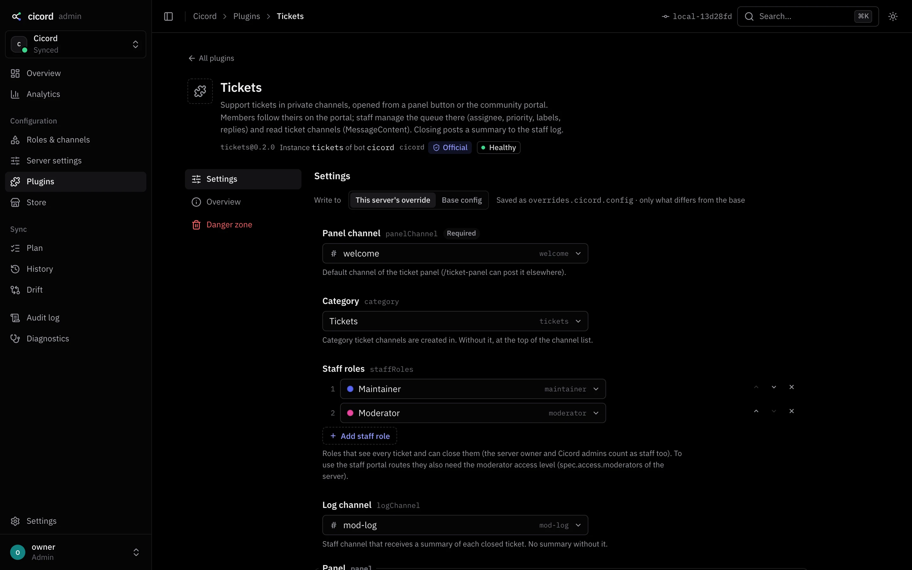

The everyday loop with Cicord is the GitOps loop: **edit, plan, merge, the runtime applies**.
This page walks through it once, on the repository written by `cicord init` in the
[quick start](../quick-start/).

## 1. Edit the YAML

Add a role and rename a channel in `servers/<key>.yaml`. With `cicord dev` running on the
directory, a save is applied at once: to preview the change first, make it in a copy of the
directory.

```yaml title="servers/my-community.yaml (excerpt)" ins={11-14} ins="events]" "general-chat"
spec:
  roles:
    moderator:
      name: Moderator
      color: "#e67e22"
      hoist: true
      permissions: [KickMembers, ModerateMembers, ManageMessages]
    member:
      name: Member
      color: "#3498db"
    events:
      name: Events
      color: "#f1c40f"
      mentionable: true

  hierarchy: [moderator, member, events]

  channels:
    general:
      name: general-chat # the key "general" stays: this is a rename, not a new channel
      type: text
      category: community
      position: 1
```

Check it offline. `cicord validate` runs the JSON Schemas and the semantic checks (references
resolve, keys are unique, plugin configs match their schemas, capabilities are granted):

```sh
cicord validate
```

```text
✓ my-community: 1 server(s), 1 bot(s), 0 plugin instance(s)
```

## 2. Preview the change with `cicord plan`

`cicord plan` computes the diff between the repository and the live servers. Nothing is
applied.

```sh
export CICORD_RUNTIME_URL=http://127.0.0.1:7420
export CICORD_RUNTIME_TOKEN=…   # the runtime token printed by cicord dev
cicord plan --remote
```

```text
Planning 6 file(s) on http://127.0.0.1:7420…
Server my-community: 2 change(s)
  + create role "Events"
      color:       "#f1c40f"
      mentionable: true
      name:        "Events"
  ~ rename channel #general → #general-chat
      name: "general" → "general-chat"

Plan: 1 to create, 1 to update, 0 to delete.
```

The symbols are `+` create, `~` update, `-` delete, `>` reorder, `=` adopt (an existing
resource with the same name), `#` stop managing (left in Discord) and `!` blocked, with the
reason. Blocked operations never fail the plan: they explain what Cicord refuses to do and
why, for example a deletion under `deletionProtection` or a banner that needs a boost level
the server does not have. See [Reconciliation](../../concepts/reconciliation/).

There are two ways to plan:

- **Through the runtime** (recommended, and what CI does): `cicord plan --remote` uploads the
  repository to your runtime, which plans it with its own state and bots. It needs
  `CICORD_RUNTIME_URL` and `CICORD_RUNTIME_TOKEN` (`cicord dev` prints its token at start).
- **Locally**: `cicord plan` without `--remote` uses the bot tokens from your environment
  (`token.secretRef`) and the local state database `.cicord/state.db`.

## 3. Ship it

How the change reaches Discord depends on where the runtime reads the repository from:

- **GitHub or another git remote** (`spec.source.provider: github` or `git`): merge to the
  tracked branch. The runtime polls every minute, or fetches at once with a GitHub webhook on
  `<public-url>/hooks/github`. To trigger a fetch by hand: `cicord sync`.
- **Managed by Cicord** (`provider: embedded`): changes are made through the admin console,
  which commits to the embedded repository.
- **A local directory** (`cicord serve --local`, or `cicord dev`): saving the file is enough;
  every save becomes a new revision and is applied at once.

With a git-backed runtime, wait until it has applied a specific commit:

```sh
cicord status --wait --revision $(git rev-parse HEAD) --timeout 10m
```

`cicord status` shows the active revision, every server's sync and health, and the bots
(here on `cicord dev --sim`, where the revision is the working tree):

```text
Runtime 0.2.0 (dev, simulator)
Revision local-7e8d38d  "working tree" by local, 2026-11-25T12:22:40Z

Servers (1)
  my-community         Synced     Healthy     synced 2026-11-25T12:22:40Z via bot

Bots (1)
  bot                  Healthy     bot (1575124454466387969)
    servers: my-community
```

## 4. Edits from the admin console come back to the repository

Everyone with access to the admin console (`<public-url>/admin/`) edits **the same files**.
When a moderator changes a plugin's settings, or an admin installs a plugin from the Store or
uploads a server icon, Cicord patches the YAML (comments and key order are kept) and,
depending on `cicord.yaml` `spec.writeBack`:

- **commits** it on the tracked branch, then activates its own commit immediately, or
- opens a **pull request**, and the change waits for review like any other.

With `cicord dev`, the files of the working directory are edited in place, with no commit.
A plugin setting lands in `bot.yaml` as a per-server override of the instance
(`overrides.<server>.config`).

The `cicord.yaml` written by `cicord init` commits plugin settings (`bots/**`) directly and
opens pull requests for edits under `servers/**` (the server icon, banner and splash uploaded
in the admin console; roles and channels are never edited there). Commits are authored by
`cicord[bot]`, with the Discord user who made the change in a `Cicord-Actor` trailer: pull
them like any other commit. See [Write-back](../../concepts/write-back/) for the policies.



## Run it in CI

`cicord init` writes `.github/workflows/cicord.yml`. On every pull request it runs
`cicord validate` and posts `cicord plan --remote --comment` on the pull request; on every push
to `main` it runs `cicord status --wait` for the merged commit, which fails, naming the
cause, when the commit is rejected, a plugin fails to start or keeps crashing, a bot is offline
or degraded, or a server is [paused](../../concepts/reconciliation/#emergency-pause-enforcement),
and times out on a blocked change; changes that only wait for a boost level pass (see
[`cicord status`](../../reference/cli/#cicord-status)). The actions are pinned by commit SHA,
and cicord by the version that generated the workflow: bump it when you upgrade the runtime.
Configure two repository settings:

| Setting | Value |
|---|---|
| `secrets.CICORD_RUNTIME_TOKEN` | The runtime's bearer token (`CICORD_RUNTIME_TOKEN` of `cicord serve`). |
| `vars.CICORD_RUNTIME_URL` | The runtime's `https://` URL. |

The URL is a repository variable on purpose: it is never read from `cicord.yaml`, so a pull
request cannot choose where the token is sent.

```yaml title=".github/workflows/cicord.yml (excerpt)"
  plan:
    if: github.event_name == 'pull_request'
    needs: validate
    runs-on: ubuntu-latest
    permissions:
      contents: read
      pull-requests: write
    steps:
      - uses: actions/checkout@3d3c42e5aac5ba805825da76410c181273ba90b1 # v7.0.1
      - uses: actions/setup-go@d8cbb8045d7f43706b9177cceb36c1f91a6644d5 # v7.1.0
        with:
          go-version: stable
      - run: go install github.com/cicord/cicord/cmd/cicord@v0.2.0
      - run: cicord plan --remote --comment
        env:
          CICORD_RUNTIME_URL: ${{ vars.CICORD_RUNTIME_URL }}
          CICORD_RUNTIME_TOKEN: ${{ secrets.CICORD_RUNTIME_TOKEN }}
          GITHUB_TOKEN: ${{ github.token }}
```

Next: learn the [repository layout](../../concepts/repository-layout/).
