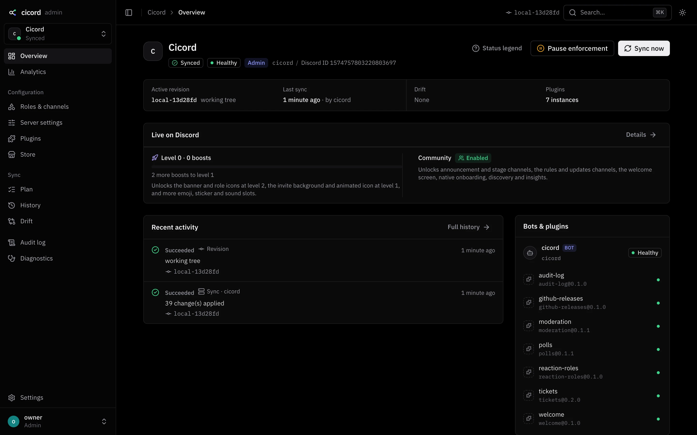

**Cicord** (*CI + Discord*) is GitOps for Discord. You describe your Discord servers and the
bots that live on them in YAML files in a git repository. A single runtime, `cicord serve`,
follows that repository, reconciles the servers continuously, runs your bots on a shared
engine and extends them with sandboxed TypeScript plugins.



:::caution[Pre-release]
Cicord is **v1alpha1**: `0.x` releases may still change file formats and APIs. Read the
[changelog](https://github.com/cicord/cicord/blob/main/CHANGELOG.md) before upgrading.
:::

## Why Cicord

Discord server settings usually live in one person's head and a few hundred clicks. Bots
are separate projects, each with its own hosting, token handling and deployment. Cicord
treats a community the way infrastructure teams treat servers:

- **Declarative.** Roles, categories, channels, permissions, Community settings, AutoMod,
  native onboarding, emojis, stickers and soundboard sounds are declared in YAML,
  Kubernetes style (`apiVersion` / `kind` / `metadata` / `spec`).
- **Reviewable.** A change is a commit. `cicord plan` shows what it would do before anything
  happens, and CI posts that plan on the pull request.
- **One engine, many bots.** One runtime hosts *N* bot identities across *M* servers. New
  revisions are hot-swapped without reconnecting to the Discord gateway.
- **Extensible and safe.** Features are TypeScript plugins with explicit capabilities. A
  plugin can only do what `bot.yaml` grants it, and only on its own server.
- **Friendly for non-developers.** The embedded admin console edits the same files: every
  save becomes a commit or a pull request. The setup wizard gets a newcomer from nothing to
  a synced server without touching git.
- **Self-hosted.** One static binary with SQLite inside (PostgreSQL is optional). No
  Node.js and no `git` binary at run time.

## Concepts in two minutes

| Concept | Where | What it is |
|---|---|---|
| **Project** | `cicord.yaml` | Repository-level settings: engine version, where the runtime reads the repository from, plugin registries, write-back policy, portal. |
| **Server** | `servers/<key>.yaml` | The desired state of one Discord server. |
| **Bot** | `bots/<key>/bot.yaml` | One Discord application (one token, one identity), the servers it joins and the plugins it runs. |
| **Plugin** | `plugin.yaml` + `src/` | A TypeScript module with a static manifest: capabilities, gateway intents, config schema. |
| **Plugin instance** | an entry of `bot.yaml` `spec.plugins` | A plugin running for one (bot, server) pair, with its own config and storage. |
| **Revision** | in the runtime | An immutable, validated and built snapshot of the repository at one commit. The runtime runs exactly one active revision. |

A few rules make everything else predictable:

- **Stable keys.** Every resource has a key that never changes (`general`), separate from
  the display name shown in Discord (`general-chat`). Renaming in YAML renames in Discord; it
  never recreates. All references use keys.
- **Only what you declare is touched.** Roles or channels you never declared are ignored.
  Deleting requires `prune: true` and turning `deletionProtection` off.
- **Configuration in git, data in the database.** XP, warnings, tickets and member
  preferences live in the runtime's database, never in git.
- **Server, never guild.** Cicord says *server* everywhere (`ManageServer`, `ServerMembers`),
  where the Discord API says *guild*.

```yaml title="servers/my-community.yaml"
apiVersion: cicord.dev/v1alpha1
kind: Server
metadata:
  name: my-community
spec:
  discordId: "112233445566778899"
  roles:
    moderator: { name: Moderator, color: "#e67e22", permissions: [KickMembers, ManageMessages] }
  channels:
    general: { name: general-chat, type: text }
```

## How it fits together

```text
          ┌─────────────────── git repository ──────────────────┐
          │ cicord.yaml  servers/  bots/  plugins/  cicord.lock │
          └──────▲──────────────────────────┬───────────────────┘
  write-back     │                          │ webhook / poll
  (admin edits)  │                          ▼
          ┌──────┴──────────────────── cicord serve ────────────┐
          │ source → validate → build → revision                │
          │   ├─ server reconciler (plan · apply · drift)       │
          │   └─ bot host (gateway sessions, plugin VMs)        │
          │ HTTP API · admin console (/admin/) · portal (/)     │
          │ state: resource map · plugin KV · audit · history   │
          └───────────────────────────┬─────────────────────────┘
                                      ▼
                                   Discord
```

Everything ships as **one Go binary, `cicord`**: the command line tool and the runtime. The
admin console and the default community portal are embedded in it.

## Where to go next

- [Installation](../installation/): a release binary, the container image, or a build from
  source.
- [Quick start](../quick-start/): the setup wizard on a real server, or `cicord dev --sim`
  offline.
- [Repository layout](../../concepts/repository-layout/): what each file is for.
