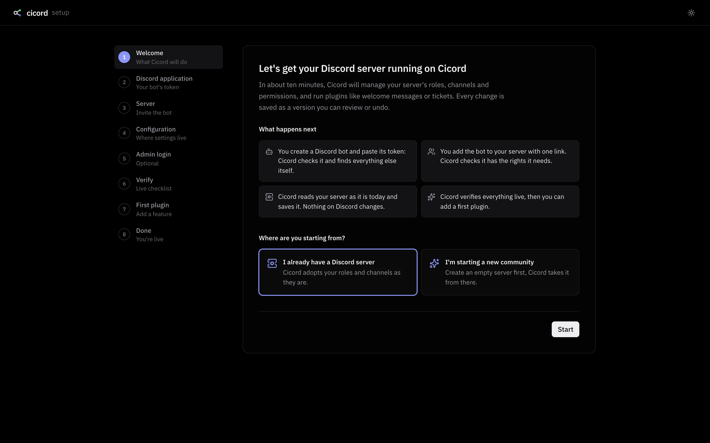

import { Steps, Tabs, TabItem } from "@astrojs/starlight/components";

There are two ways to start. The **setup wizard** connects Cicord to a real Discord server and
checks every step live. The **simulator** (`cicord dev --sim`) needs no Discord account at all.
Both assume `cicord` is [installed](../installation/).

<Tabs syncKey="quickstart">
<TabItem label="Real Discord (setup wizard)">

## Set up a real server with the wizard

Started in a directory without `cicord.yaml`, the runtime enters **setup mode** and prints a
one-time link to the setup wizard.

<Steps>

1. Start the runtime in an empty directory, with the URL people will reach it on:

   ```sh
   mkdir my-community && cd my-community
   cicord serve --public-url https://cicord.example.org
   ```

   To work on your own machine instead, run `cicord dev`: the wizard then writes the
   repository files into the directory, with hot reload. The log prints the link:

   ```text
   Cicord is not set up yet: setup mode on https://cicord.example.org
     open the setup wizard: https://cicord.example.org/admin/setup?token=…
     (this link works once; restart Cicord to get a new one)
     data: /home/me/my-community/.cicord-data
   ```

   The wizard **resumes after a restart** (its state is in the data directory); only the
   link changes. Until you finish, the runtime serves only the wizard and the health
   endpoints.

   

2. **Welcome.** Choose between an existing server and a new community (the wizard explains
   how to create a server first).

3. **Discord application.** Follow the numbered instructions in the
   [Discord developer portal](https://discord.com/developers/applications) (New
   Application, then _Bot_, _Reset Token_, _Copy_) and paste **only the token**. Cicord
   finds the application ID itself and names the privileged intents to turn on ("Server
   Members Intent", "Message Content Intent"), with a **Re-check** button. A missing intent
   is only a warning here.

4. **Server.** Open the invite link (scopes `bot applications.commands`, Administrator
   permission; see [bot permissions](../../self-hosting/bot-permissions/) to run without it),
   authorize the bot, then pick the server when it appears in the list. For a live server,
   choose **Inspect first** instead: the bot joins with View Channels only and you get a
   read-only report before granting more ([Evaluate an existing server](../evaluate-a-server/)). Cicord checks the
   bot's permissions and that **its role is above every role it will manage**; if not, it
   tells you which role to drag, for example "drag the role “Cicord” above “Admin”" in
   Server Settings → Roles.

5. **Configuration.** Choose where the configuration lives:
   - **Managed by Cicord**: a git repository inside the data directory. No git knowledge
     needed; every change is still a commit.
   - **A GitHub repository**: an HTTPS URL, a branch, and a personal access token or a
     [GitHub App](../../self-hosting/deploy/#github-access-token-or-github-app). The
     repository can be empty or have a first commit (a README).
   - With `cicord dev`, **This folder** writes the files into the current directory.

   **Import and activate** reads the server as it is and writes the repository: everything
   is **adopted**, nothing changes on Discord (if the first plan is not empty, the changes are
   shown for you to confirm). The runtime activates it without a restart.

6. **Admin login** (optional). Add the redirect URL `<public-url>/auth/callback` in the
   application's OAuth2 settings and paste the client secret, so that you can sign in to
   the admin console with Discord. **Test login** checks the round trip.

7. **Verify.** A checklist runs until everything is green: token, intents, membership,
   permissions, role hierarchy, slash commands, live events (send a message in the server
   when asked), an empty plan and a write-back probe.

8. **First plugin.** Pick one of the ten [official plugins](../../plugins/official/)
   bundled with the binary, review what it may do, configure it and install it. The wizard
   commits it and suggests a slash command to try (`/poll`, `/rank`…).

9. **Done.** Click **Finish and open the admin**. The admin console is at
   `<public-url>/admin/`.

</Steps>

:::note[Where secrets go]
Tokens and secrets pasted in the wizard are stored **encrypted** in the data directory
(key from `CICORD_SECRET_KEY`, or a generated `secret.key`). Environment variables always
take precedence. Manage them later with [`cicord secret`](../../self-hosting/backups-and-secrets/).
:::

The wizard manages one server and one bot; add more by editing the repository. It sets up no
GitHub webhook: the runtime polls every minute until you add one
([Webhooks](../../self-hosting/deploy/#webhooks)). What each step checks and writes:
[Setup wizard](../setup-wizard/).

</TabItem>
<TabItem label="Offline (simulator)">

## Try Cicord offline with the simulator

`cicord dev --sim` replaces Discord with an in-memory simulator seeded from your YAML. No
token, no Discord account.

<Steps>

1. Scaffold a repository. Without `--server-id` and `--application-id`, `cicord init` uses
   placeholder IDs that work with the simulator:

   ```sh
   cicord init my-community
   cd my-community
   cicord validate
   ```

   ```text
   ✓ my-community: 1 server(s), 1 bot(s), 0 plugin instance(s)
   ```

   The repository has a server with two roles (`moderator`, `member`), a category and two
   channels (`welcome`, `general`), one bot without plugins, and a CI workflow.

2. Start the runtime on the simulator:

   ```sh
   cicord dev --sim
   ```

   ```text
   Cicord dev runtime listening on http://127.0.0.1:7420
     admin UI: http://127.0.0.1:7420/admin/
     watching: /home/me/my-community (hot reload; admin UI edits are written to these files)
     runtime token (CLI/CI bearer): …
     Discord simulator: open the Simulator panel in the admin UI to act as users
   ```

   The simulated world has a user `owner` who owns every server, each bot invited with
   Administrator, and the users `alice`, `bob` and `charlie` (not members yet). The
   servers start empty: the first sync creates your two roles, the category and the two
   channels (the log reports `reconcile: applied` with `applied=5`).

3. Open **http://127.0.0.1:7420/admin/** and pick a simulated user under **Dev login**
   (`owner` is admin everywhere).

4. Open **Simulator** at the bottom of the sidebar to join servers, send messages, run slash
   commands, click buttons and submit modals, while you watch the reconciler and your plugins
   react.

5. Edit a file: every save becomes a new revision (hot reload), and edits made in the admin
   console are written back to your files. [Your first change](../first-change/) walks
   through it.

</Steps>

To try the **setup wizard** itself offline, run it against a simulated Discord:

```sh
cicord dev --sim --setup ./pixel-pals
```

The simulated world then has a server "Pixel Pals" with roles, channels and members, and
_Simulate_ buttons stand in for discord.com (create a bot, turn intents on, authorize the
invite, drag the role, send a message).

:::danger[Never expose dev mode]
`cicord dev` lets anyone who can reach it sign in as any user and edits the working tree. It
only answers loopback host names and is meant for your own machine only.
:::

</TabItem>
</Tabs>

## Prefer to set things up by hand?

Every step of the wizard can be done manually:

<Steps>

1. **Create the bot** in the Discord developer portal: a new application, then _Bot_ →
   reset and copy the token. Under _Privileged Gateway Intents_, enable what your plugins
   declare (`ServerMembers` for `memberJoin`, `MessageContent` to read message text).

2. **Scaffold the repository** with your real IDs:

   ```sh
   cicord init my-community --server-id <discord server id> --application-id <discord application id>
   cd my-community
   cicord validate
   ```

   To start from a server that already exists, `cicord import <server-id>` writes
   `servers/<key>.yaml` from the live server (see the [CLI reference](../../reference/cli/#cicord-import)).

3. **Invite the bot** with the `bot` and `applications.commands` scopes and the
   Administrator permission, for example
   `https://discord.com/oauth2/authorize?client_id=<application id>&scope=bot+applications.commands&permissions=8`.
   Move its role high enough: a bot can only manage roles below its own.

4. **Run the runtime** with the token in the variable named by `token.secretRef`
   (`DISCORD_TOKEN_BOT` in the repository written by `cicord init`):

   ```sh
   export DISCORD_TOKEN_BOT=...
   cicord serve --local --public-url https://cicord.example.org
   ```

   `--local` serves the directory as is. Without it, `cicord serve` follows
   `cicord.yaml` `spec.source` (see [Deploy](../../self-hosting/deploy/)).

5. **Admin login.** Set `CICORD_DISCORD_CLIENT_SECRET` (the application's OAuth2 client
   secret) and add `<public-url>/auth/callback` as a redirect URL. Server owners are admins;
   `spec.access` grants admin or moderator to roles and users.

</Steps>

Next: [make your first change](../first-change/).
