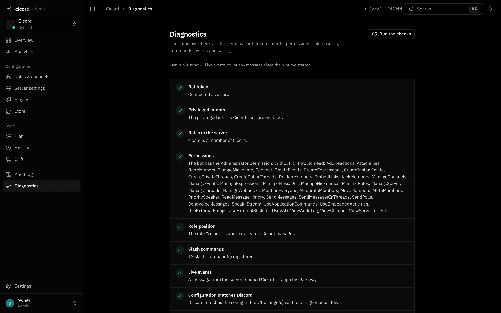

The setup wizard takes a newcomer from nothing to a synced server in the admin console:
create the bot, invite it, import the server, verify everything live, install a first
plugin. [Quick start](../quick-start/) walks through it; this page is the reference: when
the runtime enters setup mode, what each step checks and writes, and how the wizard is
secured. The endpoints are in the [HTTP API reference](../../reference/http-api/setup/).

## Setup mode

`cicord serve` and `cicord dev` decide at startup:

| Start                                                                                                                       | Result                                                                                                                                                                                       |
| --------------------------------------------------------------------------------------------------------------------------- | -------------------------------------------------------------------------------------------------------------------------------------------------------------------------------------------- |
| `cicord.yaml` in the directory                                                                                              | Normal boot. Setup mode is never entered; `cicord dev --setup` fails.                                                                                                                       |
| No `cicord.yaml`, and the setup state of the data directory says _activated_ (`cicord serve`, embedded or GitHub repository) | Boots from the repository the wizard created. If the wizard was not finished, a new setup link is printed so that it resumes.                                                               |
| No `cicord.yaml`, no setup state, but the data directory has a sync history or a `repo.git`                                 | **Refused**: the data directory belongs to an existing deployment, and the wizard must not rewrite its resource map. Run `cicord serve` in its repository, or use another `--data-dir`. |
| Otherwise                                                                                                                   | **Setup mode**.                                                                                                                                                                             |

In setup mode the runtime serves only the admin console, the setup endpoints
(`/api/v1/setup/*`), what the wizard's last steps use (the plugin catalog, the Store and
registry endpoints, plugin install and uninstall, Diagnostics) and the health endpoints:
`/healthz`, and `/readyz`, which answers `503 setup mode`. Every other `/api/*` and `/auth/*`
path answers `503` with the code `setup_required`, and `/` redirects to `/admin/setup`; the
admin console notices `setup_required` and shows the wizard. With
[`--admin-url`](../../self-hosting/security/#admin-on-a-private-network-portal-public), only the
health endpoints answer on the other hostnames.

The runtime prints a **one-time setup link** in its log (here `cicord dev --sim --setup`):

```text
Cicord is not set up yet: setup mode on http://127.0.0.1:7420
  open the setup wizard: http://127.0.0.1:7420/admin/setup?token=…
  (this link works once; restart Cicord to get a new one)
  data: /home/me/pixel-pals/.cicord/dev
  Discord simulator: the wizard creates a simulated bot and server for you
```

The admin console exchanges the token for a setup session, then removes it from the address
bar and the browser history. Opened without the token, the wizard asks you to paste the link.

The wizard's state (the current step and the answers, never a secret value) is kept in the
state store (KV scope `cicord:setup`), so the wizard **resumes after a restart**: the same data
directory and a new link continue where you left off.

| Command                        | Data directory                            | Repository choices                                                                                      |
| ------------------------------ | ----------------------------------------- | ------------------------------------------------------------------------------------------------------- |
| `cicord serve [dir]`           | `--data-dir` (default `.cicord-data`)     | **Managed by Cicord** (default) and **GitHub**                                                          |
| `cicord dev [dir]`             | `<dir>/.cicord/dev`                       | **This folder** (the files are written into `dir`, with hot reload) and **Managed by Cicord**           |
| `cicord dev --sim --setup [dir]` | `<dir>/.cicord/dev`, with the state in memory (as with `cicord dev --sim`) | the same as `cicord dev`, against the [Discord simulator](#offline-against-the-simulator) |

### Offline, against the simulator

`cicord dev --sim --setup` runs the whole wizard against the Discord simulator. Its world has
an `owner` user and a server "Pixel Pals" that already has roles (Admin, Moderator, Member),
categories (one private), text and voice channels, an AutoMod rule and members, so the import
adopts something real. Buttons
marked _Simulate_ stand in for discord.com: create a bot, turn the privileged intents on,
authorize the invite (optionally with the bot's role at the bottom, to see the hierarchy
check fail), drag the bot's role to the top, send a message. An **Inspect first** run reports the private Staff
category as hidden and the AutoMod rule as unreadable; a _Simulate_ button then authorizes the
Administrator invite. The simulator lists every channel to the bot,
so the hidden ones are named; Discord leaves them out of the list. Once the files are written,
`cicord dev --sim <dir>` runs that repository normally.

### Activation without a restart

When the Configuration step activates the repository, the runtime starts on it in the same
process, waits for the first revision to be active, then swaps the setup handler for the
full API (the setup endpoints stay mounted until **Finish**).

## Security

**The setup token**

- 32 random bytes, minted on every start in setup mode (and when an activation left the wizard
  unfinished);
- only its SHA-256 is kept, in memory, and compared in constant time;
- consumed by the first successful exchange;
- exchanged by a `POST` (`/api/v1/setup/session`, with the CSRF rules of every unsafe
  request), never by a `GET`.

**The setup session**

- stored in the session store for 24 hours and sent as its own cookie, `cicord_setup`
  (HttpOnly, `SameSite=Strict`, `Secure` behind HTTPS); it is never accepted as a
  `cicord_session` cookie;
- until the wizard completes, it is an **admin principal** on the whole API, like the runtime
  token, so the wizard can use the normal endpoints (server resources for the pickers of the
  configuration forms, plan, status) before any Discord login exists. It takes precedence over
  a Discord login made in the same browser: a **Test login** with an account that is not the
  server's owner does not lock the wizard out;
- **Finish** marks the setup complete, revokes every setup session, and makes every setup
  endpoint except the status answer `410 gone`. In dev mode, the loopback-only `Host` rules
  still apply.

**The secret store.** What you paste (the bot token, the GitHub token or App, the OAuth client
secret) is stored encrypted, never written to a file: AES-256-GCM with a random nonce per
write, the secret's name authenticated with it, ciphertexts in KV scope `cicord:secrets`, and a
sentinel ciphertext that makes a wrong key fail at startup. The API never returns a value,
and neither the bot token nor the setup token is ever logged or written to the repository.
Names, key and rotation:
[Backups and secrets](../../self-hosting/backups-and-secrets/#the-secret-store).

## The steps

Each step is validated by the runtime before you can move on.

### 1. Welcome

What will happen, and a choice between an existing server and a new community. For a new
community, the wizard explains how to create a server first.

### 2. Discord application

Numbered instructions with a link to the developer portal (New Application → Bot → Reset Token
→ Copy). You paste **only the token**.

- The runtime checks it with `GET /users/@me` and `GET /oauth2/applications/@me`, which return
  the bot's name and avatar, the **application ID** and the application's **flags**.
- The flags `GATEWAY_GUILD_MEMBERS`, `GATEWAY_MESSAGE_CONTENT` and `GATEWAY_PRESENCE`, and
  their `*_LIMITED` variants (an application in fewer than 100 servers), count as enabled.
- When Server Members or Message Content is off, the wizard names the exact toggles ("Server
  Members Intent", "Message Content Intent") and links to the application's Bot page. A
  **Re-check** button reads the flags again.
- A missing intent is a warning here, since only some plugins need one. Installing a plugin
  that needs it is refused with the same guidance.
- A bad token is explained: invalid or revoked, a user token, or an application ID or client
  secret pasted by mistake.

### 3. Server

The step first asks how the bot joins:

- **Administrator (fastest)**, the default. The invite asks for the scopes
  `bot applications.commands` and the **Administrator** permission (`permissions=8`). Cicord
  can manage everything right away, and so can anyone holding the bot token.
- **Inspect first (read-only)**. The invite asks for **View Channels** only
  (`permissions=1024`). Once the server is picked, the wizard inspects it: visible and hidden
  channels, what it could not read, what applying changes would need, and the first plan
  (empty). Nothing is changed on Discord and nothing is saved. You can stop there. To go on,
  authorize the report's upgrade link (exact permissions or Administrator) and click
  **Re-check**: **Continue** unlocks once the checks below pass. See
  [Evaluate an existing server safely](../evaluate-a-server/).

To run without Administrator, see [Bot permissions](../../self-hosting/bot-permissions/).

- **Live detection.** The page polls `GET /api/v1/setup/discord/servers` every 2.5 seconds,
  which reads the bot's servers over REST (`GET /users/@me/guilds`), so it works before the
  privileged intents are on and opens no gateway session. The server appears a few seconds
  after you click _Authorize_; pick it with **Manage this server**: there is no ID to copy.
- **Checks** (with Re-check): the bot is a member; it has Administrator, or the permissions
  Cicord needs; and its **highest role is above every role Cicord will manage**. On failure
  the wizard says what to do, for example "drag the role Cicord above Admin" (the highest role
  in the way) in Server Settings → Roles. Moving on is refused while a check fails.
- Before a configuration exists, a bot without Administrator is checked against a default
  list: View Channel, Manage Roles, Manage Channels, Manage Server, Send Messages, Embed Links,
  Read Message History, Add Reactions, Manage Messages and Moderate Members. Later checks (the
  Verify step, Diagnostics) use the exact needs of the configuration and its plugins.

### 4. Configuration

Where the configuration lives:

- **Managed by Cicord**: a bare repository at `<data dir>/repo.git`, where every change is a
  commit.
- **GitHub**: an HTTPS URL, a branch and credentials, either:
  - a **personal access token** (fine-grained, on this repository: Contents, Pull requests and
    Commit statuses, read and write), stored as `CICORD_GIT_TOKEN`. Choosing it deletes the
    stored `CICORD_GITHUB_APP_*` secrets (they would take precedence), and it is refused while
    `CICORD_GITHUB_APP_ID` is set in the environment;
  - or a **GitHub App**: its App ID, its private key (the content of the `.pem`) and,
    optionally, the installation ID. The wizard signs the App's JWT, discovers the
    installation on the repository (`GET /repos/{owner}/{repo}/installation`) when the ID is
    empty, and mints an installation token. GitHub rejecting the App ID or the key, and an App
    not installed on the repository, are explained with what to fix. The secrets are stored as
    `CICORD_GITHUB_APP_ID`, `CICORD_GITHUB_APP_PRIVATE_KEY` and
    `CICORD_GITHUB_APP_INSTALLATION_ID` (the discovered ID, so restarts do not look it up
    again). `cicord serve --github-app-key-file` provides the key as a file instead. How to
    create the App:
    [GitHub access](../../self-hosting/deploy/#github-access-token-or-github-app).

  The remote is checked (reachable with the credentials, no `cicord.yaml` yet). An empty
  repository is initialized; an existing branch (a README…) gets the setup commit on top. The
  setup state records the method (`token` or `githubApp`): a repository set up with the App
  refuses to start without its secrets instead of falling back to a token.
- **This folder** (`cicord dev` only): the files are written into the directory.

**Import and activate** then:

1. reads the server and runs the importer;
2. generates the repository files:
   - `cicord.yaml`, whose [write-back](../../concepts/write-back/) policy depends on the
     repository: every change is committed for embedded, local and git repositories; on
     GitHub, `bots/**` and `plugins/**` are committed and `servers/**` opens a pull request;
   - `servers/<key>.yaml`, plus the server's images (icon, emojis, stickers…) under
     `servers/assets/<key>/`;
   - `bots/<bot>/bot.yaml`, with the token's `secretRef`, the server, `intents:
     [ServerMessages]` (for the live-event check) and no plugins;
   - `README.md` and `.gitignore`;
3. validates them and records the resource map;
4. computes a **preflight plan** with a plan-only reconciler, before anything touches Discord.
   If it is not empty, the changes are shown and must be confirmed;
5. closes the wizard's REST session;
6. writes the **first commit** (with **This folder**, the files);
7. activates the runtime [without a restart](#activation-without-a-restart).

The first plan of the running runtime is shown as proof: nothing to change.

### 5. Admin login (optional)

Instructions for the application's OAuth2 page (a direct link), the **redirect URL** to add
(with a copy button) and the client secret.

- The secret is checked with Discord (a client-credentials grant) before it is stored.
- The application's registered redirects are read with the bot token. If the redirect URL is
  missing, saving fails with `redirect_missing`; Discord would otherwise answer "invalid
  redirect_uri" at the first login. With `cicord serve --admin-url`, both
  `<public-url>/auth/callback` and `<admin-url>/auth/callback` must be registered, and the
  error names the missing ones.
- **Test login** opens `/auth/login` in a new tab; the wizard detects the Discord session and
  shows "Signed in as …".
- The API reads the client secret on every login, so no restart is needed.
- In the simulator, the dev login replaces this step.
- You can skip it and set `CICORD_DISCORD_CLIENT_SECRET` later. The wizard warns that once
  you finish, the setup link no longer opens the admin console.

### 6. Verify

A checklist run by the runtime, polled every 2 seconds until everything is green:



| Check         | What it verifies                                                                                                                 |
| ------------- | -------------------------------------------------------------------------------------------------------------------------------- |
| `token`       | The token is valid, belongs to the application of `bot.yaml`, and the bot is connected.                                          |
| `intents`     | The application's flags against the intents the configuration needs (failure) and the recommended ones (warning).                |
| `member`      | The bot is in the server.                                                                                                        |
| `permissions` | The bot's server permissions.                                                                                                    |
| `hierarchy`   | The bot's role is above every managed role.                                                                                      |
| `commands`    | The result of the slash command registration, as recorded by the runtime.                                                        |
| `events`      | A member's message received through the gateway since the step started: you are asked to send one.                               |
| `plan`        | The plan is empty.                                                                                                               |
| `writeback`   | A no-op write-back succeeds: clone or fetch with the credentials, no commit. For `cicord dev`, only write access to the directory. |

The slower results (the token and application lookup, the plan, the write-back probe) are
cached for 15 seconds per server, so polling stays cheap for Discord and git. The live checks
(member, permissions, hierarchy, commands, events) run every time.

### 7. First plugin

The **bundled catalog**: the official plugins embedded in the binary at build time (welcome,
onboarding, tickets, polls, levels, moderation, reaction-roles, audit-log, announcements,
voice-rooms).

- Pick a plugin to review it: its capabilities in plain words, its gateway intents, the
  websites it may call, and its slash commands (found by building and inspecting the plugin).
- Configure it with the configuration form, whose pickers are fed by the live server.
- **Install**:
  1. the plugin's privileged intents are checked against the application's flags;
  2. the whole repository plus the plugin is validated on a copy (schema, references, build);
  3. write-back copies the sources to `plugins/<name>/` and appends the instance, with every
     declared capability granted, to `bots/<bot>/bot.yaml`;
  4. the wizard waits for the new revision, shows the instance's health, then suggests the
     slash command to try (`/poll`, `/rank`…).

### 8. Done

A summary, links to the admin console, the portal and the CLI (`cicord plan --remote`), and
**Finish and open the admin**, which completes the setup.

## Diagnostics

`GET /api/v1/servers/{server}/diagnostics` (admin) runs the same checks at any time, wizard or
not. The admin console has a **Diagnostics** page per server
(`/admin/servers/<key>/diagnostics`). For the checks that need the runtime's view, it records
the last member message seen per server and the last slash command registration result per bot
and server.

## The plugin catalog

The wizard's catalog is the sources of the ten official plugins, embedded in the binary at
build time (`plugin.yaml`, `config.schema.json`, `tsconfig.json`, `src/*.ts`; never
`node_modules` or build output). `GET /api/v1/catalog` lists them for admins. After the
setup, the admin console's **Store** adds the plugins of [registries](../../plugins/publishing/).

## Known gaps

- After a restart, the runtime uses the public URL the wizard ran on; `--public-url` or
  `CICORD_PUBLIC_URL` overrides it.
- If the first activation fails, **Import** can be clicked again: it reuses the running
  runtime, which keeps following the repository.
- In `cicord dev`, a restart between the first commit and the activation resumes the wizard as
  activated, since the runtime now runs the files.
- GitHub authentication is a personal access token or a GitHub App created by hand (no App
  manifest flow yet). There is no webhook step: the runtime polls every minute until you set
  `CICORD_WEBHOOK_SECRET` yourself ([Webhooks](../../self-hosting/deploy/#webhooks)).
- The wizard's catalog lists the official plugins only, at the versions bundled with the
  binary.
- `cicord serve` restarted in a directory that still has no `cicord.yaml` boots from the
  persisted embedded or GitHub repository. Moving that runtime elsewhere means copying the data
  directory (it holds the repository, the state and `secret.key`).
- The wizard manages one server and one bot. Add more by editing the repository.
