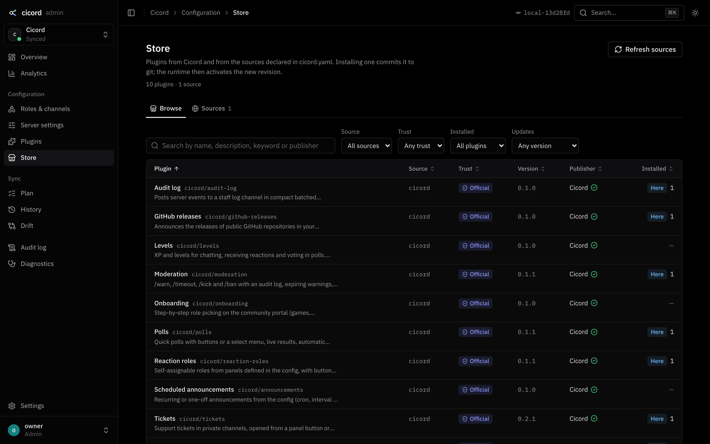

Everything a Cicord bot *does* comes from plugins: greeting members, tickets, polls, levels,
moderation… A plugin is a small TypeScript module with a static manifest. It runs sandboxed
inside the runtime, one **instance** per (bot, plugin instance, server), and can only do what its grants
allow.

## Sources and trust

Plugins are installed from **sources**, like apt sources or Homebrew taps:

| Source | What it is | Trust |
|---|---|---|
| **`cicord`** | The eleven [official plugins](../official/), published in the signed official registry [github.com/cicord/cicord-plugins](https://github.com/cicord/cicord-plugins); ten of them are also bundled with the binary, for offline and first installs. Always available, no configuration. | `official` |
| **Registries** | Git repositories with an `index.yaml`, declared in `cicord.yaml` `spec.registries`. Community collections, your organization's private plugins, your own development registry. | `unofficial` |
| **Local plugins** | A directory of your repository (`plugins/<name>/`), referenced by path. | `local` |

Trust is **computed from the URL, never declared**: a registry can't call itself official. The
admin console labels unofficial sources everywhere and asks for an explicit confirmation,
restating the capabilities and network access being granted, before installing from them.

Source `cicord` merges the bundled plugins with the
[official registry](../publishing/#the-official-registry), whose index is only used when its
signature verifies against the keys built into the binary (see
[source `cicord`](../publishing/#source-cicord-and-the-bundled-plugins) for which copy wins).

## The Store

The admin console's **Store** page lists every source and its plugins, with search and trust
badges. Selecting a plugin shows what it requests before anything is installed:

- its **capabilities**, in plain words;
- its gateway **intents**, privileged ones highlighted;
- the **websites** it may call (`http.fetch` allow-list);
- its slash commands (for official plugins; an unofficial plugin's code never runs before
  you install it, so only its `plugin.yaml` is read).



Install then asks for the bot, the instance name and the configuration (a form generated from
the plugin's schema, with pickers for channels and roles). The installed code is exactly the
reviewed version: if a new release appears between the review and the click, the Store asks
you to review again.

Under **Sources**, admins add or remove registries (`https://` only in the admin console),
including private ones with a token. Adding or removing a source changes `cicord.yaml`, so it
needs the admin role on every server.

## Installing from the command line

```sh
cicord registry add acme https://github.com/acme/cicord-plugins.git
cicord registry search xp
cicord plugin add acme/xp --bot moderator
```

`cicord plugin add <registry>/<plugin>[@<range>]` adds an instance to the bot (`--name` sets the
instance key, default the plugin name) and locks the version in `cicord.lock`. It works with
the registries declared in `cicord.yaml` and with the official registry:

```sh
cicord plugin add cicord/welcome --bot moderator   # from github.com/cicord/cicord-plugins
```

Installing from a registry adds `source: <registry>/<plugin>` with a `version` range to the
bot and a `cicord.lock` entry. An official plugin lands in one of two ways:

- **From the official registry** (`cicord plugin add cicord/<name>`, or the Store when the
  registry has a newer version than the bundled one): `source: cicord/<name>`, locked like any
  registry plugin.
- **As a copy of the bundled plugin** (the Store otherwise, the setup wizard always): the
  sources are copied to `plugins/<name>/` and the instance is local.

Either way, the change is one [write-back](../../concepts/write-back/) commit or pull
request, and every capability the plugin requests is granted, as reviewed.

## Updating

Cicord compares each locked version with the highest release tag of the plugin's repository
(any major version) and offers **Update to X** in the Store, the Plugins table, the plugin's
Store page (its main action) and the instance's page, all leading to the same update review.
On the Store page of an installed plugin without an update, the main action opens its
instance; **Install another instance** adds the plugin a second time, with its own name,
settings and data (on the same or another bot), which is rarely needed. The update review
shows:

- what the new version requests compared with the installed one (capabilities, intents,
  network hosts);
- what changes for each instance (version range, grants);
- whether the current settings are still valid with the new config schema.

Updating rewrites the lock entry, widens the instances' version range when needed
(`^1.0.0` → `^2.0.0`) and sets their grants to what the new version requests, for every
instance at once (the version is shared), so it needs the admin role on every server where the
plugin runs. Unofficial sources ask again for an explicit confirmation restating what is newly
granted. As for installs, the code updated to is exactly the reviewed code: if the release
changed in between, the update is refused (`409 changed`) and asks for a new review.

```sh
cicord plugin update                       # list available updates
cicord plugin update acme/xp               # update to the latest version, print the capability diff
cicord plugin update acme/xp --to ^2.0.0   # or to a range (written to every instance)
cicord plugin update cicord/welcome        # an official plugin
```

Copies of official plugins in `plugins/<name>/` update from the binary: a newer Cicord may bundle
a newer version. A copy you changed is not overwritten unless you force it (admin console
checkbox, or `--force`). An official plugin locked from the official registry
(`cicord/<name>` in `cicord.lock`) updates from the registry, like any registry plugin.

## Uninstalling

From a plugin's page in the admin console, **Uninstall** removes the instance from the bot
(only this server, when the instance runs on several). When no other instance uses the
plugin, its `cicord.lock` entry or its copied `plugins/<name>/` directory goes too. Its stored
data is kept.

## `cicord.lock`

`cicord.lock` pins every registry plugin. It is generated (`cicord plugin add`,
`cicord plugin update`, the Store); do not edit it by hand.

```yaml title="cicord.lock"
# Generated by cicord — do not edit by hand.
lockVersion: 1
plugins:
  cicord/welcome:
    version: 0.1.0
    repo: https://github.com/cicord/cicord-plugins
    path: plugins/welcome
    commit: 5287d31b787c56f4aff6d7c6dd1e782935c29c1a
    integrity: sha256-tLhHLsg0zfcMXDcM25woNCl3Y5TVTeAjE1ftRVFg2DY=
    capabilities:
      - discord.messages.send
      - discord.channels.read
      - discord.members.read
      - discord.roles.assign
      - discord.dm.send
      - portal.links
      - storage.kv
```

- The runtime refuses a registry plugin that is missing from `cicord.lock`, or whose content
  does not match `integrity`.
- `integrity` is `sha256-<base64>` over the plugin's files sorted by path. Paths are relative
  to the plugin directory (`path`, or the repository root), so a plugin hashes the same in its
  own repository and in a monorepo. Symlinks and submodules are not part of a plugin. `path`
  is absent for a plugin at the root of its repository.
- Because the capabilities are recorded, a permission change of a plugin shows up in the diff
  of a pull request.
- Local plugins are not locked: they are part of your repository.

## Configuring plugins

Instances are declared in `bots/<bot>/bot.yaml` (see [Bot](../../configuration/bot/#plugin-instances)).
Their settings are also editable in the admin console, on pages generated from each plugin's
`config.schema.json`: admins edit every field, moderators the fields the plugin marks
`x-cicord-access: moderator`. Saves are written back like any other change.
