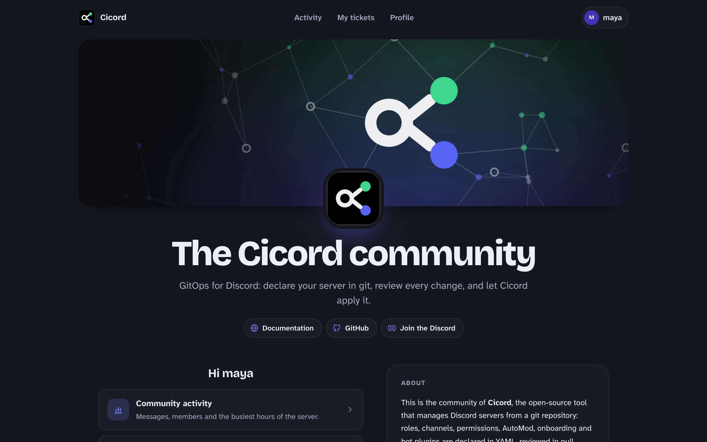
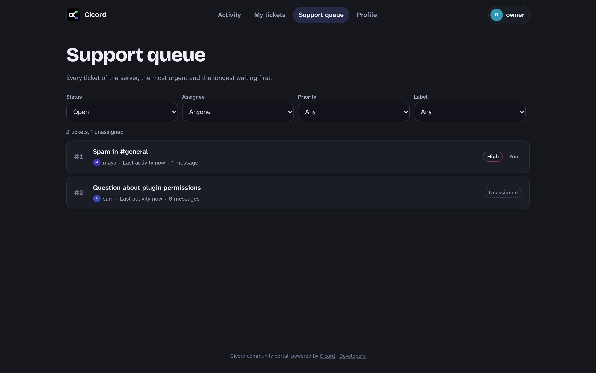
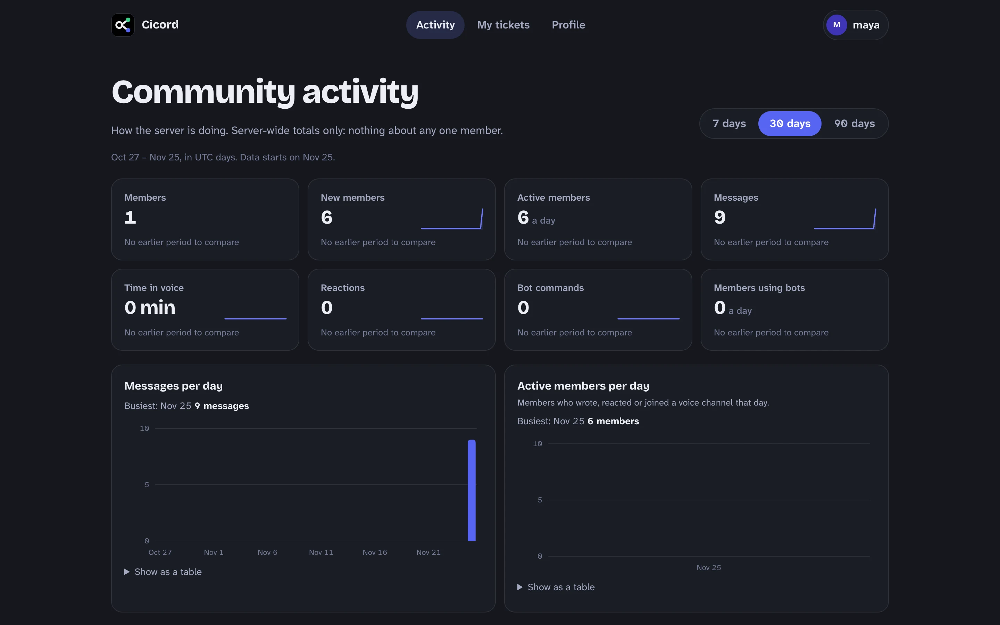

import { FileTree, Steps } from "@astrojs/starlight/components";

When theming and YAML options are not enough, fork the reference portal into your repository.
The runtime then serves **your build** at `/`, from the active revision.

<Steps>

1. **Scaffold** it inside your Cicord repository (the directory with `cicord.yaml`):

   ```sh
   cicord portal init            # → portal/   (or: cicord portal init <dir>)
   ```

2. **Build** it:

   ```sh
   cd portal && pnpm install && pnpm build
   ```

3. **Point the runtime at the build** in `cicord.yaml`:

   ```yaml title="cicord.yaml"
   spec:
     portal:
       path: ./portal/dist # the build output, relative to cicord.yaml
   ```

4. **Commit everything**, the build included:

   ```sh
   git add portal .github cicord.yaml   # sources, pnpm-lock.yaml, vendor/ AND dist/
   ```

5. From then on, `cicord portal build` (from the repository root) installs when
   `node_modules` is missing, regenerates the route types and builds into `spec.portal.path`.

</Steps>

## What `cicord portal init` writes

The reference portal is React 19 with Vite+.

<FileTree>

- portal/
  - src/
    - pages/ Home, Onboarding, Profile, Leaderboard, Tickets, Developers, NotFound
    - portal.tsx server selection, theme, navigation, sign-in
    - i18n/ en, fr
    - mock/ an in-browser fake runtime for `pnpm dev`
    - cicord-routes.d.ts the types of the repository's plugin routes
  - test/ Vitest and Testing Library, against the mock
  - vendor/ `@cicord/client`, `@cicord/react`, `@cicord/ui` tarballs, from the cicord binary
  - package.json `file:` dependencies on vendor/
  - pnpm-workspace.yaml overrides that keep `@cicord/*` on vendor/
- .github/
  - workflows/
    - cicord-portal.yml rebuilds and checks the committed build

</FileTree>

The workflow and `cicord-routes.d.ts` are only written when the directory is inside a Cicord
repository. `--force` writes into a non-empty directory.

By default the `@cicord/*` packages are **vendored**: the tarballs embedded in the `cicord`
binary are written to `vendor/` and referenced as `file:` dependencies. `@cicord/react`
depends on `@cicord/client` by version, so `pnpm-workspace.yaml` overrides it to the vendored
tarball too (pnpm reads overrides there, not in `package.json`): nothing comes from the npm
registry. `grep "@cicord/client@" portal/pnpm-lock.yaml` only shows `file:vendor/…` entries.

`cicord portal init --from-npm` (or `CICORD_FROM_NPM=true`) depends on the packages published
on npm instead (`"@cicord/client": "^<version of cicord>"`, same for react and ui), with no
`vendor/` and no `@cicord/*` overrides.

### Upgrading cicord

The vendored tarballs are those of the `cicord` that wrote them. After upgrading cicord, bring
them to the new version:

```sh
cicord portal vendor          # or: cicord portal vendor portal
cd portal && pnpm install && cd ..
cicord portal build
```

`cicord portal vendor` replaces the `@cicord/*` tarballs in `vendor/` with the ones embedded in
the binary, points `package.json` and `pnpm-workspace.yaml` at them (nothing else changes) and
deletes the old ones. `cicord portal vendor --check` changes nothing and fails when they differ.
Also bump the cicord version that `cicord-portal.yml` installs. A portal on the npm registry
(`--from-npm`) is left alone: bump its `^` ranges yourself.

### From the vendored tarballs to npm

In `portal/package.json`, replace each `"file:vendor/…"` by a version range (`"^<version of cicord>"`), delete
the `@cicord/*` entries of the overrides (`portal/pnpm-workspace.yaml`, and `package.json` if
it has any), delete `vendor/`, then `pnpm install`. `cicord plugin new --from-npm` does the
same for `@cicord/sdk` in a plugin.

### The Developers page

The **Developers** page is a live map of the SDK: the session (cookie or token), every portal
endpoint with the SDK call that uses it, every plugin route of the server (GET routes can be
called from the page), and the raw `PortalServer`. Its navigation link is shown to moderators
and admins and in development (mock mode, `cicord dev --sim`); the URL `/developers` always
works. Delete the page in your fork if you do not want it.

## Why the build is committed

The runtime has no Node.js and only sees what is in the git revision it applies, so the build
output must be in that revision. The served portal is then exactly what was reviewed, with
every source provider (GitHub, git, embedded, local) and no artifact storage. Building in CI
without committing would need a side channel outside GitOps; building in the runtime would put
Node.js and package installs inside it. If you prefer CI to make the commit, replace the check
step of `cicord-portal.yml` by a build and a commit on `main` (that commit becomes a new
revision).

The generated `.github/workflows/cicord-portal.yml` runs on pull requests and pushes that touch
`portal/`, `plugins/`, `bots/` or `cicord.lock`. It installs the release binary of the cicord
version that generated it, after verifying its checksum and build provenance
(`gh attestation verify`): a `go install` build has no portal kit to compare the vendored
packages with. It checks the route types
(`cicord portal typegen --check`) and the vendored packages (`cicord portal vendor --check`),
runs the portal's tests, rebuilds it and **fails when the committed `dist/` differs from the
fresh build**, so reviewers only need to read `src/`. Locally, `cicord portal build --check`
does the same for the build.

The runtime serves `<active revision>/<path>` at `/` with an SPA fallback, swaps it with every
new revision (no restart), and never lets it shadow `/api`, `/auth`, `/hooks`, `/admin`,
`/healthz` or `/readyz`. Hashed files under `assets/` are cached for a year, everything else is
revalidated. Files are read through a root confined to the portal directory: `..` and symbolic
links leading outside are refused.

`cicord validate` checks `spec.portal.path`: outside the repository, through a symbolic link or
not a directory is an **error**; missing, or without `index.html`, is a **warning**, and the
runtime serves the default portal until the build is committed, so that a missing build never
blocks the reconciliation of servers and bots.

:::caution
A custom portal is code running on the runtime's origin, like the admin console. Review it
like code.
:::

## Typed plugin routes

`cicord portal init` and `cicord portal build` write `src/cicord-routes.d.ts`; `cicord portal typegen`
regenerates it on its own. It describes the routes of **every plugin installed in the
repository** (every instance of every bot, local or from a registry), keyed by plugin name
then route key, with their access level, path parameters and the query, body and response
types of each plugin's [route contract](../../plugins/api/#typed-routes) (`spec.routes.types`
in `plugin.yaml`). Routes of plugins without a contract are typed as untyped JSON. The file is
a module augmentation of `PluginRouteRegistry` (`@cicord/client`); commit it.

```tsx
import { useRouteMutation, useRouteQuery } from "@cicord/react";

// The instance is found by plugin name in PortalServer.plugins; no instance → idle query.
const board = useRouteQuery("levels", "GET /leaderboard", { query: { limit: 50 } });
board.data?.items[0]?.displayName; // typed from the levels contract

const mine = useRouteQuery("tickets", "GET /tickets/mine/:id", { params: { id } });
const create = useRouteMutation("tickets", "POST /tickets", {
  onSuccess: (ticket) => navigate(`/tickets/${encodeURIComponent(ticket.id)}`),
});
create.mutate({ body: { subject, description } });
```

Without React, `@cicord/client` has the same typed calls:

```ts
const levels = server.plugins.find((p) => p.plugin === "levels");
if (!levels) return;
const top = await client.routes("levels", server.key, levels).call("GET /leaderboard");
client.routes("levels", server.key, levels).url("GET /leaderboard"); // a URL only
```

Untyped calls stay available: `client.plugin(server, bot, instance).get("/leaderboard")` or
`usePluginQuery(ref, "/leaderboard")`.

An unknown route, a missing or extra path parameter, a wrong query or body and a wrong use of
the response are type errors, so a portal build (`tsc --noEmit && vp build`) fails when a plugin
changes its contract. `cicord portal typegen --check` and `cicord portal build --check` fail
when the file is out of date.

A plugin the generated file does not list falls back to the contracts of the official plugins
(`levels`, `polls`, `tickets`, `onboarding`: `OfficialPluginRoutes` in `@cicord/client`), else
to untyped JSON, so the reference portal type-checks in a repository without them. The
reference portal's own `cicord-routes.d.ts` is generated from `examples/showcase`.

## Dev loop

Two terminals:

```sh
cicord dev --sim                     # runtime + Discord simulator on http://127.0.0.1:7420
cd portal && pnpm dev:runtime        # Vite dev server on http://localhost:5174, hot reload
```

`pnpm dev:runtime` proxies `/api` and `/auth` to `CICORD_RUNTIME_URL` (default
`http://127.0.0.1:7420`, the default of `cicord dev`), so the page and the API are same-origin
and cookie sessions work. For a runtime on another port:

```sh
cicord dev --sim --listen 127.0.0.1:7433
CICORD_RUNTIME_URL=http://127.0.0.1:7433 pnpm dev:runtime
```

`vite.config.ts` handles two protections of dev mode, as the admin console does:

- `cicord dev` only answers loopback `Host` headers (DNS-rebinding protection): the proxy keeps
  `Host: localhost:5174`, which is loopback;
- unsafe requests must carry the runtime's own `Origin` (CSRF protection): the proxy rewrites
  the `Origin` of the dev page (`http://localhost:5174` or `http://127.0.0.1:5174`) to the
  runtime's, and passes any other `Origin` through, so the runtime still rejects other sites.
  The port is strict: when 5174 is busy, the dev server stops instead of moving.

`cicord dev --sim` has no Discord OAuth (`/auth/login` answers `503`). When the runtime runs the
simulator, the portal's sign-in block lists the simulated users (from `GET /api/v1/sim/state`)
and signs in with `POST /auth/dev-login`. From a shell, with an ID that `cicord dev` prints
(`simulated user alice: …`):

```sh
curl -X POST -H 'X-Cicord-Request: 1' -H 'Content-Type: application/json' \
  -d '{"userId":"<user id>"}' http://127.0.0.1:7420/auth/dev-login
```

Other loops:

- `pnpm dev` (mock mode) needs no runtime at all: `src/mock` fakes the API in the browser
  (`?role=moderator` previews the moderator pages, `?mode=light` the light palette);
- `cicord dev` also serves the committed build: run `pnpm build` (or `cicord portal build`) and
  the next revision serves it at `http://127.0.0.1:7420/`;
- `pnpm test` runs the portal's tests (Vitest and Testing Library, against the mock).

## Example: the Cicord community portal

[community.cicord.dev](https://community.cicord.dev) is a fork in the `portal/` directory of
[cicord/cicord-community](https://github.com/cicord/cicord-community), the repository of
Cicord's own Discord server. It keeps the reference portal's shell, theme, Home, Profile and
Developers pages, drops Onboarding and Leaderboard, and adds:

| Path                                       | Page                                                                                                                                                                       | Built on                                                                   |
| ------------------------------------------ | -------------------------------------------------------------------------------------------------------------------------------------------------------------------------- | -------------------------------------------------------------------------- |
| `/activity`                                | Server activity: members, joins, active members, messages, voice, reactions, bot usage, the busiest public channels and a weekday × hour heatmap in the viewer's time zone | `usePortalAnalytics(period)`, with `spec.analytics.portal: members`        |
| `/tickets`, `/tickets/new`, `/tickets/:id` | A member's own tickets: open one, follow it, reply                                                                                                                         | The tickets plugin's member routes (`GET /tickets/mine`, `POST /tickets`…) |
| `/support`, `/support/:id`                 | The staff queue: filter, assign, set priority and label, reply, close and reopen                                                                                           | The moderator routes (`GET /tickets`, `GET /staff`, `PATCH /tickets/:id`…) |







The configuration behind it:

```yaml title="cicord.yaml"
spec:
  portal:
    path: ./portal/dist
```

```yaml title="servers/cicord.yaml"
spec:
  analytics:
    presence: true
    portal: members # signed-in members of the server see the Activity page
  access:
    admins: { roles: [maintainer] }
    moderators: { roles: [moderator] } # the staff side of the tickets plugin needs moderator access
```

```yaml title="bots/cicord/bot.yaml"
spec:
  plugins:
    - name: tickets
      source: cicord/tickets
      version: ^0.2.0
      grants:
        [
          discord.messages.send,
          discord.messages.read,
          discord.channels.read,
          discord.channels.manage,
          discord.members.read,
          storage.kv,
          portal.routes,
        ]
      config:
        staffRoles: [maintainer, moderator]
        maxOpenPerMember: 1
```

Pages are shown by capability, not by configuration keys: the tickets pages appear when the
server's tickets instance serves their routes, so a server still on tickets 0.1 shows neither.

```ts title="portal/src/tickets/api.ts"
export function useTicketsPlugin(route: string): PortalPlugin | undefined {
  const { instance } = usePortalPlugin("tickets");
  return instance?.routes.includes(route) ? instance : undefined;
}
```

The Activity page asks for `7d`, `30d` or `90d` and handles the three answers of a server that
does not share its activity with the viewer: `not_found` (`spec.analytics.portal` is `off`),
`unauthenticated` (sign in) and `forbidden` (not a member of the server). The staff view edits
tickets optimistically: it patches the detail in the `@cicord/react` cache (`useCicord().cache`,
`cicordKeys.plugin(…)`), sends the request, and restores the detail if it fails.
