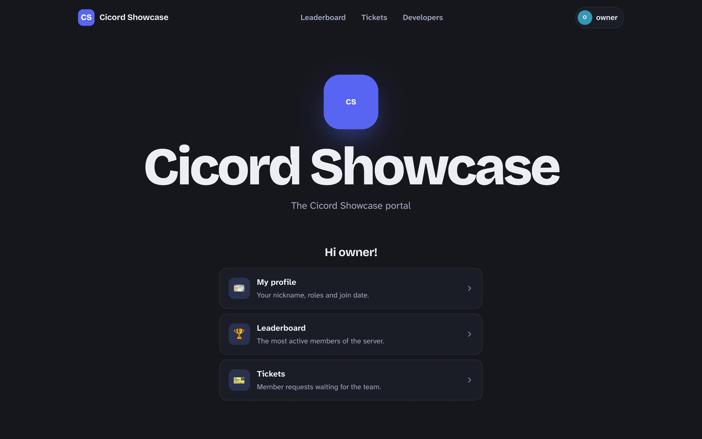

The community portal is the public face of a server: a home page, sign-in with Discord,
onboarding, member profiles, leaderboards, tickets… In Cicord it is **an SDK, not a fixed
app**, so every community can have its own
([ADR-0008](../../project/decisions/0008-community-portal-sdk/)).

The runtime serves a complete **reference portal** at `/` out of the box. Declaring
`spec.portal` in a server's YAML publishes that server on it.

## Four levels of customization

From the least to the most effort, a community can:

1. **Theme it** from YAML: primary and accent colors, logo, light or dark mode.
2. **Customize it without code**: title, tagline, Markdown description, banner, links, pages,
   language. See [Customize from YAML](../customize/).
3. **Fork it** with `cicord portal init`, change anything, and have the runtime serve your build
   from the repository. See [Custom portal](../custom-portal/).
4. **Embed it in another site** (a fan site with its own domain and design), in token mode. See
   [Embedding](../embedding/).

## The pages of the reference portal

| Page | Shows | Needs |
|---|---|---|
| Home | Title, tagline, description, banner, links | |
| Onboarding | Step-by-step role picking | The [onboarding plugin](../../plugins/official/#onboarding) |
| Profile | The member's roles and data | Sign-in |
| Leaderboard | XP ranking | The [levels plugin](../../plugins/official/#levels) |
| Tickets | Open tickets, for moderators | The [tickets plugin](../../plugins/official/#tickets) |
| Community tools | Available activities, member forms and staff workflows at `/community` | An installed plugin exposing a supported route |
| Developers | A live map of the SDK: session, every portal endpoint, every plugin route | Linked for moderators, admins and in development |

A page that needs a plugin only appears when the server runs that plugin. `spec.portal.pages`
turns off Onboarding, Profile, Leaderboard and Tickets. The interface is in English and French.

**Plugin pages.** The Tools link lists the features exposed by the selected server.
Each link keeps the bot and plugin instance, including when a server runs several
instances of a plugin. Member and staff forms send requests to that instance under
the current viewer’s session. The server checks access again on each request.

| Audience | Available workflows |
|---|---|
| Everyone | Event calendar and ICS subscription, published suggestions, poll totals, giveaway draw proofs and season standings |
| Members | Verification, personal moderation history, birthday preferences, invitation standings, tag search, wallet, transactions and reward shop |
| Authorized staff | Moderation case filters, appeals, verification queue, announcements with previews and scheduling, shift coverage, suggestion decisions, transaction ledger, tag editing, unanswered questions, audit search and export, guard rules and incidents |

A Discord case link can open an appeal or a verification result for a former member.
The result page calls only its scoped plugin route. The staff shift editor also supports
members granted a plugin-specific staff role. Calendar subscriptions point directly to
the public ICS route. Reward orders reuse the same purchase identifier after a network
interruption, so a retry can retrieve the order without charging twice.

The reference portal has no activity page: the server activity that
[`spec.analytics.portal`](../../self-hosting/analytics/#configuration) shares is shown by a
custom portal, such as the [Cicord community's](../custom-portal/#example-the-cicord-community-portal).

## How members get in

- **Sign in with Discord** (OAuth2). The runtime needs `CICORD_DISCORD_CLIENT_SECRET` and the
  redirect URL `<public-url>/auth/callback` registered in the Discord application.
- **Links from bots.** A plugin calls `ctx.portal.link("/onboarding", { member })` and sends
  the result, typically in a DM with a button. Opening it signs that member in, restricted to
  that one server, for a short time (15 minutes by default, `expiresInSeconds` up to 24 hours).

A typical onboarding: a member joins → the `welcome` plugin sends a DM with a button → the
themed portal opens, signed in → the member picks roles → the `onboarding` plugin applies them.

## Plugins on the portal

Plugins expose **routes** (`definePlugin({ routes })`, served under
`/api/v1/portal/<server>/plugins/<bot>/<instance>/…` with an access level). A portal (the
reference one, a fork, an embedding site) finds a plugin's instance in `PortalServer.plugins`
by **plugin name**, never by hard-coded bot or instance keys, and calls its routes through the
SDK, typed from the plugin's route contract
([Typed plugin routes](../custom-portal/#typed-plugin-routes)). The reference portal's
Leaderboard and Tickets pages work this way.

There is no server-driven UI, and plugin JavaScript is never injected into a portal at run
time: the portal stays code you review. A plugin may also ship optional React components, as a
package that portals import at build time, reviewed and pinned like any dependency.

## The SDK

| Package | Role |
|---|---|
| `@cicord/client` | Typed, framework-agnostic client of the runtime API: auth (cookie or token mode), portal endpoints, plugin routes. |
| `@cicord/react` | Provider, data hooks and headless components such as `<OnboardingFlow>`. |
| `@cicord/ui` | Optional styled components driven by the server theme. |
| `create-cicord-portal` | The reference portal, meant to be forked with `cicord portal init`. |

See [SDK packages](../sdk/).

:::note[Inside Discord?]
Running the portal inside the Discord client as an Activity is a proposed option
([ADR-0016](../../project/decisions/0016-portal-as-discord-activity/)),
not implemented.
:::
