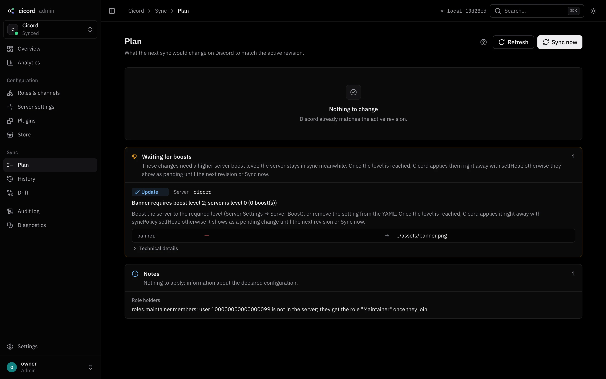

Goal: everything a server owner can set in Discord **and** that the bot API allows is
declarable in YAML, one to one; the rest is listed here as "Discord only". The tables compare
the Discord server settings UI with the [`Server`](../../configuration/server/) resource.

**Legend.** **Yes**: declared in YAML and reconciled. **Not yet**: the API allows it, Cicord does
not support it yet. **Discord only**: not settable by a bot. **Data**: runtime data, not
configuration.

## Server profile and overview

| Discord setting | Cicord | Field and notes |
|---|---|---|
| Name | Yes | `profile.name` |
| Icon | Yes | `profile.icon`; an animated (GIF) icon needs boost level 1. Also uploadable from the admin console's Server settings. |
| Banner image | Yes | `profile.banner`; boost level 2, an animated (GIF) banner level 3. Also uploadable from the admin console's Server settings. |
| Invite splash | Yes | `profile.splash`; boost level 1. |
| Discovery splash | Discord only | Needs Discovery. |
| Description | Yes | `profile.description`; shown for Community and Discovery servers. |
| Preferred locale | Yes | `profile.preferredLocale` |
| Boost progress bar | Yes | `profile.premiumProgressBar` |
| Profile banner color, traits, games played, private profile, server tag | Discord only | Not in the public API. |

## Engagement

| Discord setting | Cicord | Field and notes |
|---|---|---|
| System messages channel | Yes | `profile.systemChannel` |
| System message toggles | Yes | `profile.systemChannelFlags`: `welcomeMessages`, `welcomeStickerReplies`, `boostMessages`, `setupTips`, `roleSubscriptionMessages`, `roleSubscriptionStickerReplies` |
| Default notifications | Yes | `profile.defaultNotifications` |
| Inactive (AFK) channel and timeout | Yes | `afk: { channel, timeout }` |
| Server widget | Yes | `widget: { enabled, channel }` |
| Activity feed | Discord only | |

## Access and safety

| Discord setting | Cicord | Field and notes |
|---|---|---|
| Verification level | Yes | `profile.verificationLevel` |
| Explicit (sensitive) content filter | Yes | `profile.explicitContentFilter` |
| Safety alerts channel | Yes | `community.safetyAlertsChannel` |
| Join mode (invite only, apply, discovery), age-restricted server, rules screening form, 2FA requirement for moderation, members in channel list | Discord only | |

## Community

| Discord setting | Cicord | Field and notes |
|---|---|---|
| Enable Community | Yes | `community.enabled`; prerequisites (rules and updates channels, verification at least low, content filter on all members) are checked by `cicord validate` and blocked in the plan with the missing list. |
| Rules channel | Yes | `community.rulesChannel` (`profile.rulesChannel` is a deprecated alias); blocked in the plan without Community. |
| Community updates channel | Yes | `community.updatesChannel` |
| Welcome screen | Yes | `welcomeScreen` |
| Onboarding (questions, default channels, mode) | Yes | `onboarding`; see [Native onboarding and the onboarding plugin](#native-onboarding-and-the-onboarding-plugin). |
| Announcement channels | Yes | `type: announcement`; they need Community (stage channels too): blocked in the plan without it, created right after Community is enabled. |

## Roles

| Discord setting | Cicord | Field and notes |
|---|---|---|
| Name, color, hoist, mentionable, permissions, hierarchy | Yes | `roles`, `hierarchy` |
| Gradient and holographic colors | Yes | `roles.*.colors`; boost level 2. `color` stays the solid shorthand. |
| Role icon image | Yes | `roles.*.icon`; boost level 2. |
| Role icon emoji | Yes | `roles.*.emoji`; exclusive with `icon`, boost level 2 too. |
| Role holders | Yes | `roles.*.members`: listed users get the role; additive, unlisted holders keep it. |
| `@everyone` permissions | Yes | `everyone.permissions` |
| Linked roles (role connections) | Not yet | Application-level metadata. |

## Channels and categories

| Discord setting | Cicord | Field and notes |
|---|---|---|
| Name, type, category, position, topic, NSFW, slowmode, overwrites, sync with category | Yes | |
| Voice bitrate, user limit, region, video quality | Yes | `bitrate`, `userLimit`, `voiceRegion`, `videoQuality` |
| Thread "hide after inactivity", thread slowmode | Yes | `threadArchiveAfter`, `threadSlowmode` |
| Forum and media: tags, default reaction, sort order, layout, guidelines | Yes | `tags` (keyed; IDs kept on rename), `defaultReaction`, `sortOrder`, `layout`, `guidelines` |
| Stage channels | Yes | `type: stage`; need Community, like announcement channels. |
| Spoiler channel | Not yet | To verify in the API. |
| Channel webhooks | Not yet | Planned (they involve secrets). |
| Invites | Not yet | Declared permanent invite links are planned. |

## Expressions and moderation

| Discord setting | Cicord | Field and notes |
|---|---|---|
| Emojis | Yes | `emojis: { key: { name, image, roles } }`; emojis beyond the slots of the boost level are blocked in the plan. A changed image file needs a new key (Discord cannot replace it). |
| Stickers | Yes | `stickers: { key: { name, description, emoji, file } }`; slots per boost level, a changed file needs a new key, as for emojis. |
| Soundboard sounds | Yes | `soundboard: { key: { name, sound, volume, emoji } }`; same slot and file rules. |
| AutoMod rules (mention spam, spam, keyword presets, custom keywords, actions, exemptions) | Yes | `automod: { key: {...} }`; adopted by name and trigger, rule caps blocked in the plan. |
| Bans, scheduled events | Data | Handled by plugins, not configuration. |
| Audit log | Data | Read-only. |
| Server template, boost perks | Discord only | |

## Boost level and Community gating

The planner reads the server's live boost level and feature flags (`boostLevel`,
`boostCount`, `features` and `community` in the [server status](../http-api/servers/#runtime-status))
and blocks what the server cannot use yet, instead of failing on apply:

| Gate | Blocked until | Plan reason |
|---|---|---|
| Animated icon, invite splash | boost level 1 | `boost: invite splash requires boost level 1; …` |
| Banner, role icons (image or emoji), gradient role colors | boost level 2 | `boost: banner requires boost level 2; server is level 0 (0 boost(s))` |
| Animated banner | boost level 3 | `boost: animated banner requires boost level 3; …` |
| Emojis, stickers, sounds beyond the slots | a higher boost level (below 3) | `boost: maximum number of stickers reached (5 at boost level 0); a higher boost level gives more slots` |
| Announcement and stage channels, welcome screen, onboarding, rules, updates and safety alerts channels | Community on (`community.enabled`) | `community: the welcome screen requires the Community feature (set community.enabled: true)` |

A server that has a feature flag without the boosts (partnered and verified servers) is not
blocked. Changes that only wait for a boost level stay listed in the plan but are not drift:
the server stays `Synced` and the admin's Plan page shows them under "Waiting for boosts".
Once the server reaches the level, the server update event makes Cicord plan again: with
`selfHeal` it applies them right away; otherwise they become pending changes (`OutOfSync`)
until the next revision or **Sync now**. At level 3, slot limits
are final (`limit:`, drift like any other blocked change).



A banner declared on a server at boost level 0, in `cicord plan` and `cicord status`:

```text
Server showcase: no changes, 1 waiting for boosts
  ^ waits for boost: update server showcase (banner requires boost level 2; server is level 0 (0 boost(s)))
      banner: (none) → "./assets/banner.png"

No changes. Discord matches the configuration; 1 change(s) wait for a higher boost level.
```

```text
Servers (1)
  showcase             Synced     Healthy     synced 2026-11-25T12:27:46Z via cicord
    1 change(s) wait for a higher boost level
```

`cicord import` (and the setup wizard's import) downloads the server icon, banner and invite
splash, role icons, emojis (GIF when animated), stickers and soundboard sounds from the
Discord CDN into `servers/assets/<server>/` and records them as uploaded, so the first plan is
empty. Files over Discord's upload limits and managed emojis are reported and skipped;
`cicord validate` checks the size of declared files (10 MiB for server images, 256 KiB for
role icons and emojis, 512 KiB for stickers and sounds).

Hand edits of managed AutoMod rules, emojis, stickers and soundboard sounds reach the
reconciler through the gateway (`AUTO_MODERATION_RULE_*`, `GUILD_EMOJIS_UPDATE`,
`GUILD_STICKERS_UPDATE`, `GUILD_SOUNDBOARD_SOUND_*`) and trigger [self-heal](../../concepts/reconciliation/#drift-and-self-heal).

## Example

From the server of the [Cicord community](https://github.com/cicord/cicord-community)
(`servers/cicord.yaml`, trimmed):

```yaml title="servers/cicord.yaml (excerpt)"
spec:
  profile:
    name: Cicord
    icon: ../assets/icon.png
    banner: ../assets/banner.png # boost level 2: waits in the plan until the server reaches it
    verificationLevel: medium
    explicitContentFilter: allMembers
    systemChannel: general
    systemChannelFlags:
      welcomeMessages: false # the welcome plugin greets new members
      boostMessages: true
      setupTips: false
  community:
    enabled: true
    rulesChannel: rules
    updatesChannel: discord-updates
    safetyAlertsChannel: mod-log
  channels:
    help:
      name: help
      type: forum
      category: support
      guidelines: One post per question. Search first, then tell us your Cicord version.
      tags:
        question: { name: Question, emoji: "❓" }
        solved: { name: Solved, emoji: "✅" }
      sortOrder: latestActivity
      layout: list
      threadArchiveAfter: 1w
  automod:
    mention-spam:
      name: Mention spam
      trigger: mentionSpam
      mentionLimit: 5
      mentionRaidProtection: true
      actions:
        block: { message: Too many mentions in one message. }
        alert: mod-log
        timeout: 1h
      exemptRoles: [maintainer, moderator]
  onboarding:
    enabled: true
    defaultChannels: [welcome, rules, announcements, changelog, general, showcase, off-topic, help,
                      development, plugins]
    prompts:
      - key: releases
        title: Get pinged for new releases?
        singleSelect: true
        options:
          - title: "Yes, ping me in #changelog"
            emoji: "🔔"
            roles: [changelog-ping]
  welcomeScreen:
    enabled: true
    description: GitOps for Discord - declare your server in git, review changes, let Cicord apply them.
    channels:
      - { channel: rules, description: Read the rules, emoji: "📜" }
      - { channel: help, description: Ask a question, emoji: "❓" }
```

Every field is described in [Server](../../configuration/server/).

## Behavior observed on real Discord

Verified on a test server with Community enabled by Cicord:

- **Default mention spam rule.** A Community server lists a "Block Mention Spam" rule created
  by Discord's AutoMod system user (`1008776202191634432`). It is a placeholder: `PATCH` and
  `DELETE` answer 404, and it does not count toward the caps. Cicord ignores it, and declaring
  a real `mentionSpam` rule replaces it.
- **Once-per-server triggers** (`mentionSpam`, `spam`, `keywordPreset`, `memberProfile`): an
  existing rule with that trigger is adopted whatever its name, and renamed, also when the
  mapped rule was deleted and recreated by hand.
- **The mention spam rule cannot be deleted on a Community server** (403, code 200006):
  removing its key with prune is blocked in the plan (`undeletable`); set `enabled: false`
  instead.
- **Onboarding default channels must be open to `@everyone`** (`ViewChannel`, plus `Connect`
  for voice and stage; Discord's `DEFAULT_CHANNEL_REQUIRES_EVERYONE_ACCESS`), and 5 of the
  counted channels must let `@everyone` send messages. `cicord validate` reports both when
  `spec.everyone` is declared.
- **Roles can share a position.** After a drag in the Discord client, the API can list several
  roles at the same position; Discord then ranks the older role (lower ID) higher. Cicord turns
  positions into distinct ranks in that order, so hierarchy checks and the reorder planner see
  the real hierarchy.

## Native onboarding and the onboarding plugin

They are complementary and can run together:

- **Discord onboarding** (`spec.onboarding`) runs inside the Discord client when a member joins
  a Community server: default channels and a few questions that grant roles and channels. It
  needs Community, and at least 7 default channels (5 where `@everyone` can send messages) in
  default mode.
- **The Cicord [onboarding plugin](../../plugins/official/#onboarding)** runs on the community
  portal (and with `/onboarding`): richer steps, custom logic, state in its KV storage, links
  to the portal profile. It works on any server.

A typical setup keeps the essential interest roles in Discord onboarding, so members see them
right away, and uses the plugin for everything else; both can grant the same role keys.

## Not verified on real Discord yet

Stickers, soundboard sounds, gradient role colors and role icons are implemented and tested on
the simulator, but still untested on a real server (they need boosts). The widget, onboarding
and welcome screen have no Discord events, so manual changes to them are only seen at the next
plan.
