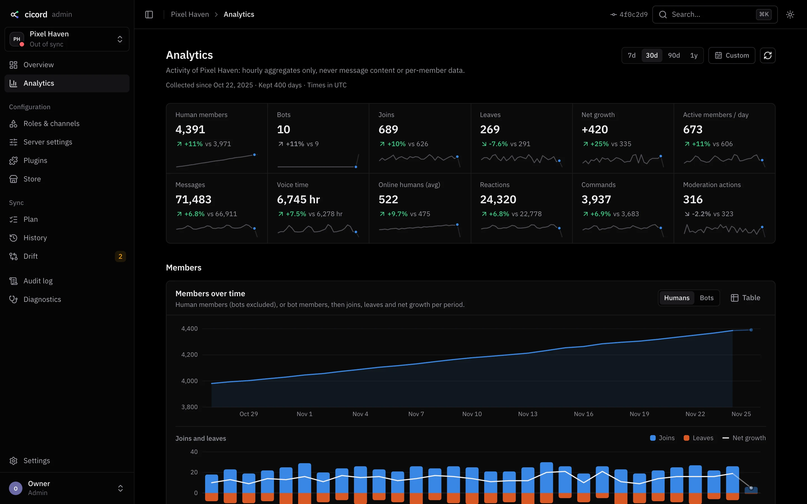

The runtime keeps **activity analytics** for every server it manages: member growth, messages
per channel, voice time, reactions, invites, moderation actions, commands. Moderators and
admins see them on the server's analytics dashboard in the admin console, and the
[analytics API](../../reference/http-api/analytics/) serves the same data.

Analytics are **on by default**. They are stored in the runtime's state database (SQLite in
the data directory, or PostgreSQL), next to the resource map and the audit log. No external
service is involved.

## Privacy

Cicord stores **aggregates only**:

- **Counts per hour and per server.** A point is a number such as "messages sent in
  `#general` between 14:00 and 15:00 UTC". It never records who sent them.
- **Bounded dimensions.** A dimension is a channel, role, AutoMod rule or scheduled event ID,
  an emoji, a command name, an invite code, or a fixed label such as `<7d` or `ban`. A member
  ID or name is never a dimension.
- **No content.** No message text, attachment, file name or link is read or stored. Messages
  are only counted.
- **Distinct members via daily tokens.** To count distinct active members, the runtime keeps
  an opaque token per active member and per day: an HMAC of the member ID with a key that
  changes every day and is never stored with the tokens. Once the day is over, the tokens are
  counted into `members.active*` and deleted, so no per-member trace outlives the day.
- **Presence is opt-in.** Statuses, platforms and activities need the privileged
  `ServerPresences` intent and `spec.analytics.presence: true`. Without them, only Discord's
  approximate online count is sampled, a single number per server.

Analytics cover only the servers declared in the repository. Direct messages are never
counted.

## What is collected

Points are **hourly**, aligned on UTC hours. A metric has a **kind**:

- **counter**: values add up (messages in the hour). Summed over days and weeks.
- **gauge (last)**: a sampled value; a period keeps its latest sample (member count).
- **gauge (max)**: the period's highest value (most members in voice at once).
- **daily distinct**: written once per day, at 00:00 UTC, from the daily tokens. Today's value
  is counted live; a week shows the average of its days.

A metric with a **dimension** is stored per dimension value (per channel, per emoji…). The
dashboard shows its top values, the rest as "other", and the total.

### Members

| Metric | Kind | Dimension | Unit | Source |
|---|---|---|---|---|
| `members.total` | gauge (last) | — | members | Human members: Discord's approximate member count minus the bot members, sampled |
| `members.bots` | gauge (last) | — | members | Bot members (accounts Discord flags as bots): the member list, read once a day and kept current by join and leave events |
| `members.online` | gauge (last) | — | members | Human members online, idle or do not disturb: counted from presences when detailed presence is collected, otherwise Discord's approximate online count minus the bot members (taken as all online), sampled |
| `members.joined` | counter | — | count | Member join events |
| `members.left` | counter | — | count | Member leave events (leaves, kicks and bans) |
| `members.joined.age` | counter | account age | count | Member join events: age of the Discord account (`<1d`, `<7d`, `<30d`, `<1y`, `>=1y`) |
| `members.joined.bots` | counter | — | count | Bot accounts added |
| `members.roles.added` | counter | role | count | Member update events |
| `members.roles.removed` | counter | role | count | Member update events |
| `members.boosting` | gauge (last) | — | count | Server boosts, sampled |
| `server.boost.tier` | gauge (last) | — | level | Server boost level (0-3), sampled |
| `members.active` | daily distinct | — | members | Distinct members active in the day (message, reaction, voice or command) |
| `members.active.chat` | daily distinct | — | members | Distinct message authors in the day |
| `members.active.voice` | daily distinct | — | members | Distinct members in voice in the day |
| `invites.uses` | counter | invite | count | Invite use counts compared before and after each join (vanity URL included) |
| `invites.created` | counter | — | count | Invite create events |
| `onboarding.completed` | counter | — | count | Member updates: Discord onboarding completed |

### Messages

| Metric | Kind | Dimension | Unit | Source |
|---|---|---|---|---|
| `messages.sent` | counter | channel | count | Message events (members, not bots) |
| `messages.sent.bots` | counter | channel | count | Message events from bots and webhooks |
| `messages.edited` | counter | channel | count | Message update events |
| `messages.deleted` | counter | channel | count | Message delete events |
| `messages.attachments` | counter | channel | count | Attachments of new messages (their number) |
| `messages.replies` | counter | channel | count | New messages that reply to another |
| `messages.stickers` | counter | — | count | Stickers of new messages |
| `reactions.added` | counter | emoji | count | Reaction add events (a unicode emoji, or `name:id` for a custom one) |
| `threads.created` | counter | channel | count | Thread create events (dimension: the parent channel) |
| `polls.created` | counter | channel | count | New messages carrying a Discord poll |

### Voice and events

| Metric | Kind | Dimension | Unit | Source |
|---|---|---|---|---|
| `voice.seconds` | counter | channel | seconds | Voice state events: time members spend in each voice channel |
| `voice.sessions` | counter | channel | count | Voice state events: joins of a voice channel |
| `voice.peak` | gauge (max) | — | members | Voice state events: most members in voice at once |
| `voice.streaming` | counter | channel | seconds | Voice state events: time streaming or with the camera on |
| `stage.seconds` | counter | channel | seconds | Voice state events in stage channels |
| `events.interested` | gauge (last) | event | members | Scheduled events: interested members, sampled |

### Moderation and safety

| Metric | Kind | Dimension | Unit | Source |
|---|---|---|---|---|
| `moderation.actions` | counter | action | count | Audit log entry events (`ban`, `unban`, `kick`, `timeout`, `untimeout`, `prune`, `message_delete`, `role_update`…) |
| `automod.triggers` | counter | rule | count | AutoMod action execution events |
| `automod.blocked` | counter | — | count | AutoMod action execution events that blocked a message |

### Bot and commands

| Metric | Kind | Dimension | Unit | Source |
|---|---|---|---|---|
| `commands.used` | counter | command | count | Application command interactions handled by the runtime (slash, user and message commands), with the subcommand (`ticket close`) |
| `components.used` | counter | bot | count | Button and select menu interactions with Cicord's bots |

### How members use the bots

Every bot of the server counts, not only Cicord's: what is used, where, when, and by whom
in aggregate. Discord only sends an interaction to the bot it belongs to, so the commands
of other bots (a music bot, a moderation bot…) are counted from their **replies**: a bot's
public reply to a command carries the command's name and who used it. A command answered
only privately (an ephemeral reply) or not answered is not seen. Cicord's own bots are
counted from their interactions, every command.

| Metric | Kind | Dimension | Unit | Source |
|---|---|---|---|---|
| `bots.commands` | counter | bot command (`Jockie Music /play`) | count | Commands used, by bot and command |
| `bots.commands.channels` | counter | channel | count | Channels where bot commands are used |
| `bots.commands.tenure` | counter | member tenure (`<1d`, `<7d`, `<30d`, `<1y`, `>=1y`) | count | How long the members using Cicord's commands have been in the server |
| `members.active.bots` | daily distinct | — | members | Distinct members who used a bot command in the day (also counted in `members.active`) |

The "why" cannot be read from Discord; the dashboard answers it from these: when
(weekday × hour), where (channel), who (newcomers or long-time members) and what (which
command of which bot). As everywhere, only counts are kept: never who used which command.

### Presence (opt-in)

| Metric | Kind | Dimension | Unit | Source |
|---|---|---|---|---|
| `presence.status` | gauge (last) | status | members | Presence events: `online`, `idle`, `dnd` |
| `presence.platform` | gauge (last) | platform | members | Presence events: `desktop`, `mobile`, `web` |
| `presence.activity` | gauge (last) | activity | members | Presence events: what members are playing, listening to or watching (`playing:Minecraft`), top activities only |

`GET /api/v1/servers/{server}/analytics/catalog` returns the same list, with whether each
metric is collected right now.

## Intents and permissions

Analytics read the gateway events of the bot that **collects** the server: the first bot, by
key, that lists it in `spec.servers`. When analytics are enabled, the runtime adds the
non-privileged intents they need to that bot itself (`ServerMessages`,
`ServerMessageReactions`, `ServerVoiceStates`, `ServerInvites`, `ServerModeration`,
`AutoModerationExecution`). What you provide is the rest:

| Metrics | Need |
|---|---|
| `members.bots`, `members.joined*`, `members.left`, `members.roles.*`, `onboarding.completed` | `ServerMembers` (privileged) in the bot's `spec.intents`; without it, `members.total` and `members.online` include the bots |
| `messages.attachments`, `polls.created` | `MessageContent` (privileged): without it, Discord sends messages without their attachments and polls |
| `moderation.actions` | The **View Audit Log** permission |
| `invites.uses`, `automod.*` | The **Manage Server** permission (invite use counts, AutoMod executions) |
| `presence.*` | `ServerPresences` (privileged) and `spec.analytics.presence: true` |

Everything else needs nothing more. The bot also needs **View Channel** in a channel to
receive its events: a private channel the bot cannot see is not counted. Commands of other
bots are seen in the channels where the collecting bot reads their public replies.

When something is missing, those metrics are **not collected** and the rest still is. The
dashboard and the API's `status.missing` name the metrics concerned, the reason and the fix;
the catalog reports them as `"collected": false`. Points recorded before keep showing.

Privileged intents must also be enabled in the Discord developer portal (Bot → Privileged
Gateway Intents; see [Gateway intents](../../configuration/bot/#gateway-intents)). Keep
presence off unless you need it: it is the most sensitive data and the most gateway traffic.

## Configuration

`spec.analytics` in the [server file](../../configuration/server/#analytics):

```yaml title="servers/my-community.yaml"
spec:
  analytics:
    enabled: true     # default: analytics are collected when the block is absent
    retention: 400d   # default 400d
    presence: false   # default: only Discord's approximate online count
    portal: off       # default; members or public share activity in the community portal
```

- `enabled: false` stops collection for the server. Points already recorded stay until
  retention removes them, and the dashboard still shows them.
- `retention` is a number of days, from `1d` to `9999d` (`cicord validate` rejects other
  values). Older points are deleted.
- `presence: true` aggregates statuses, platforms and activities, with the `ServerPresences`
  intent.
- `portal` shares a curated view with the community, through
  [`GET /api/v1/portal/{server}/analytics`](../../reference/http-api/portal/#activity):
  `members` for the signed-in members of the server (`401` signed out, `403` for others),
  `public` for anyone; `off`, or `enabled: false`, answers `404`. It covers the last 7, 30 or
  90 days: members, joins, active members, messages, voice time, reactions, bot commands and
  members using bots, the top 5 channels by messages, the top 8 bot commands and a weekday ×
  hour heatmap of messages. Only channels `@everyone` can see are named, and nothing is per
  member. The reference portal does not show it: a custom portal does, with
  `usePortalAnalytics` (see the
  [Cicord community portal](../../portal/custom-portal/#example-the-cicord-community-portal)).

## Retention and storage

- Points older than the retention are deleted periodically, per server.
- Daily tokens are deleted as soon as their day is rolled up into `members.active*`.
- One row is stored per metric, dimension and hour with activity, in the tables
  `analytics_points` (buckets in unix seconds) and `analytics_active`. A busy server with
  a hundred active channels keeps a few million rows over 400 days. Backups of the state
  database include analytics ([Backups and secrets](../backups-and-secrets/)).

## The dashboard

The analytics page of a server in the admin console (moderators and admins, on the
[admin host](../security/#admin-on-a-private-network-portal-public) when you use one) shows:



- the headline numbers of the last 7, 30, 90 or 365 days (calendar days in UTC, today
  included) or of a **custom range** (dates and times, widened to whole UTC hours, up to 400
  days), each compared with the period before: members, joins, leaves, net growth, active
  members (average per day), messages, voice time, online members (average of the samples),
  reactions, commands and moderation actions, with a sparkline per day (per hour for a range
  under two days);
- rankings: channels by messages and by voice time, emojis, invites, commands, moderation
  actions, AutoMod rules, roles added, account ages of new members, bot commands, channels
  where bots are used, and activities when presence is on;
- weekday × hour heatmaps of messages and of bot commands (UTC);
- a bot usage section: commands over time by bot, members using bots per day, the top
  commands and channels, and how long the members using Cicord's commands have been in the
  server;
- charts of any metric by hour, day or week, split by channel, role, emoji…

Channel, role and emoji IDs are shown with their current name. A channel or role that no
longer exists is marked as deleted.

## Prometheus

The [Prometheus metrics](../monitoring/) describe the runtime (revisions, syncs, bots, plugins,
HTTP). Community activity is not exported there: use the dashboard or the
[analytics API](../../reference/http-api/analytics/), which a script can read with the
[runtime token](../../reference/http-api/authentication/).
