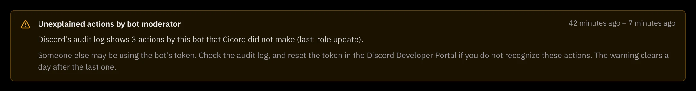
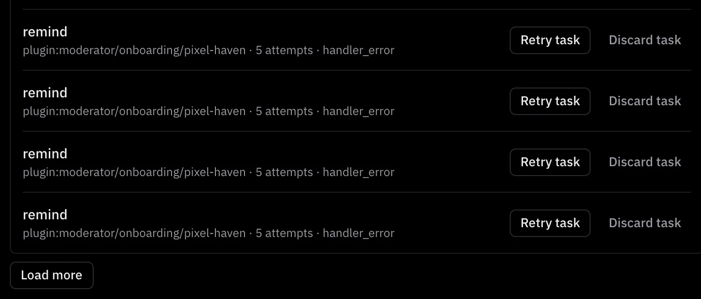

A runtime tells how it is doing in five ways: health endpoints, its logs, a live event stream,
[built-in alerts](#alerts) to a person, and Prometheus metrics. The admin console's overview
shows the same state to people.

## Health checks

The API listener (port 7420) answers two unauthenticated endpoints, in plain text:

| Endpoint | Answer |
|---|---|
| `GET /healthz` | `200 ok` while the process serves HTTP. |
| `GET /readyz` | `200 ready` once a revision is active; `503 no active revision` before, `503 setup mode` while the setup wizard runs. |

`cicord healthcheck` calls `/healthz` and exits `0` on `200`, `1` otherwise (`--url`,
`--timeout`, default 3 s): the image is distroless, without `curl`, and the
[VPS install](../production-vps/)'s `compose.yaml` uses it as the container health check,
which its automatic updates wait for, with the service check below, before keeping a new version.

```yaml
healthcheck:
  test: ["CMD", "cicord", "healthcheck"]
  interval: 30s
  timeout: 5s
  retries: 3
  start_period: 30s
```

Readiness says that a configuration runs, not that every server is in sync: watch the sync
state with the metrics below, `cicord status`, or the admin console.

`cicord healthcheck --service` checks the **service** rather than the process: it runs
[`cicord status --wait`](../../reference/cli/#cicord-healthcheck) against the runtime
and exits `0` once the active revision is loaded, every server is `Synced` (changes waiting for
a boost level are fine) and not paused, and every bot and plugin instance is `Healthy` (an
installation disabled with `enabled: false` counts as ready: it is a reviewed state); `1`
otherwise, or after `--timeout` (default 5 minutes); `2` without a runtime token. It
authenticates with `CICORD_RUNTIME_TOKEN`, else with the secret store of `--data-dir`, and
sends the admin host (`CICORD_ADMIN_URL`) since the admin API only answers there. The VPS
updater accepts a new version with it:

```sh
docker exec cicord cicord healthcheck --service --data-dir /data --timeout 5m
```

## Logs

`cicord serve` logs to standard error in logfmt (`key=value`), at the level of `--log-level`
(`debug`, `info` by default, `warn`, `error`). With Docker, read them with
`docker logs cicord`. Revisions, syncs, bot connections and plugin crashes are logged, and
plugin logs (`ctx.log`) carry the bot, server, plugin and instance (here `cicord dev --sim` on
`examples/showcase`):

```text
time=2026-11-25T13:25:58.178+01:00 level=INFO msg="activating revision" revision=local-5b7678c message="working tree"
time=2026-11-25T13:25:58.452+01:00 level=INFO msg="reconcile: applied" revision=local-5b7678c server=showcase server=showcase applied=32 failed=0
time=2026-11-25T13:25:58.461+01:00 level=INFO msg="tickets ready" bot=cicord instance=tickets server=showcase bot=cicord plugin=tickets instance=tickets server=showcase handler=start name="" staffRoles=2
time=2026-11-25T13:25:58.461+01:00 level=INFO msg="revision active" revision=local-5b7678c servers=1 instances=7
```

Syncs are also recorded in the state store: the sync history and the server's
[audit log](../../reference/http-api/servers/#audit-log), both in the admin console.

## Live events

`GET /api/v1/events` is a Server-Sent Events stream of change hints (status, syncs, plugin
crashes and restarts, new analytics points, `stopping` on shutdown), for moderators and admins
or the runtime token. The admin console uses it to refresh live; a script can follow it the
same way. See [Events](../../reference/http-api/events/).

## Alerts

`cicord serve` can tell a person when something breaks, without a Prometheus stack: give it a
webhook URL and it posts an alert when a problem starts, and one **resolved** message when it
is over.

```sh
# the encrypted secret store (recommended), then restart the runtime
docker exec -i cicord cicord secret set CICORD_ALERT_WEBHOOK --data-dir /data   # paste the URL, Enter
docker restart cicord
docker exec cicord cicord alert test --data-dir /data                          # the drill
```

`CICORD_ALERT_WEBHOOK` in the environment, or `--alert-webhook`, take precedence over the store.
The URL is read at startup. Without it, `cicord serve` logs `alerts: no CICORD_ALERT_WEBHOOK`.

- **A Discord webhook** (`https://discord.com/api/webhooks/…`, from a private channel's
  **Integrations → Webhooks**) gets one embed per alert, colored by severity, with every
  mention disabled.
- **Any other `https` URL** gets a JSON document: `{"source": "cicord", "text": "<one line per
  alert>", "alerts": [...]}`. The `text` field is what Slack, Mattermost and similar incoming
  webhooks display; the `alerts` carry the fields below for a script or an incident tool.

| Alert | Fires when | Resolved when |
|---|---|---|
| Plugin handler failing | a handler of an instance (a command, button, form, event, route…) failed 3 times in a row, even if its other handlers work | that handler succeeds again, or a new revision replaced the instance |
| Plugin instance degraded / missing | the instance crashed (and is restarting), failed to start, 3 of its handler calls failed in a row, it has [failed tasks](#failed-plugin-tasks), or a required plugin secret is missing | it is `Healthy` again |
| Bot offline / degraded | a bot could not connect to Discord | it is connected again |
| Server sync failing / unreachable | a server's sync failed (`Degraded`), or no bot can reach it (`Missing`) | it is `Healthy` again |
| Revision rejected, source fetch failing | a revision failed validation or its plugins failed to build (the previous one keeps running), or the source could not be fetched | a revision is activated |
| Server paused / resumed | a server's enforcement was paused | it was resumed |
| Bot token possibly compromised | Discord recorded an audited action by a project bot that matches no operation Cicord emitted (only for a bot that receives audit log events: the `ServerModeration` intent, which a plugin with `auditLogEntry` or ban events requests, and View Audit Log). Shown in `cicord status`, on the server's Overview in the admin console and in the status API (`unconfirmedAudit`) too. It does not change any health, so it never blocks `status --wait` or an update | no such action for a day |
| Backup failed, update postponed or rolled back | sent by the [VPS scripts](../production-vps/) | (sent once) |



Every alert names the **runtime** (the host of `--public-url`), the **server** (key and name),
the **bot**, the **plugin instance** and plugin version, the **workflow** (what was running:
`modal open`, `command /ticket`, `sync`, `revision activation`, `pause`, `backup`…), the active
revision, and links to the admin console page (`--admin-url`) where the error is. It never
contains a secret, the text of a plugin's error (which can quote what a member typed) or any
Discord content: only Cicord's own messages (a sync error, a health message), with URL
credentials and token-like strings removed.

**No storms.** A problem fires once. When it clears, the resolved message waits until it stayed
clear for 5 minutes (the time after which the runtime stops counting a restarted plugin as
crash-looping), so a crash loop or a flapping sync is one incident: one alert, one
resolved message (which says how often it came back meanwhile). Pause, resume and revisions
resolve at once. Messages are batched (up to 10 per webhook call) and spaced by 5 seconds; a
webhook that fails or answers `429` is retried with a backoff.

The notifier watches the runtime's own change bus (the one behind the
[live events](#live-events)) and re-reads the status every 15 seconds. It runs inside the
runtime: **it cannot report that the runtime itself is down.** Pair it with an external
uptime check of `GET /healthz` (an uptime service, or your provider's monitoring), or with the
`CicordDown` Prometheus rule below.

### Failed plugin tasks

Scheduled tasks and event deliveries are retried with a backoff. One that still fails is
parked as a **dead letter**, and its instance turns `Degraded` until someone decides. Admins
see them in the admin console's **Diagnostics**, oldest first, 100 at a time: **Retry task**
delivers it again, **Discard task** drops it. The reason shown is a failure category
(`handler_error`…), never the plugin's error text. The same list is in the
[HTTP API](../../reference/http-api/plugin-instances/#failed-scheduled-tasks). While a task
is parked, `cicord status --wait` and the service check fail, so the VPS updater postpones
updates: retry or discard it.



### Alert drill

Run a drill when you set alerts up and after each change of the webhook:

1. `cicord alert test` sends a test alert: check that it reaches the people on call.
2. Break something on purpose on a test server: for example a plugin handler that throws
   (`throw new Error("drill")` at the top of a command), pushed as a revision. Use the command
   three times: one **Plugin handler failing** alert arrives, naming the server, the bot, the
   instance and `command /<name>`, while `/healthz` still answers `200`.
3. Revert the change: one **resolved** message follows, 5 minutes later.

The same drill runs in the test suite on the Discord simulator, with the tickets plugin of
`examples/showcase` failing at ticket creation
([`internal/alert/drill_test.go`](https://github.com/cicord/cicord/blob/main/internal/alert/drill_test.go)).

`cicord alert send` posts an alert from a script, with the same webhook (exit `0` sent, `1`
failed, `2` no webhook):

```sh
docker exec cicord cicord alert send --data-dir /data --severity critical \
  --title "Disk almost full" --detail "/ is 92% full" --workflow disk
```

## Prometheus metrics

`cicord serve` can expose [Prometheus](https://prometheus.io/) metrics: the active revision,
the last sync of each server, the changes applied to Discord, the gateway connection of each
bot, the plugin instances (running, crashes, handler errors and durations), the HTTP API,
webhook deliveries, and the Go runtime and process. They are **off by default**.

### Enable the metrics

Give `cicord serve` an address for its metrics listener, with `--metrics-listen` or
`CICORD_METRICS_LISTEN`:

```sh
cicord serve --metrics-listen 127.0.0.1:9420
```

The runtime then answers `GET http://127.0.0.1:9420/metrics` in the Prometheus text format
(`text/plain; version=0.0.4`). The listener serves nothing else: every other path answers
`404`, and every method but `GET` and `HEAD` answers `405`. If the address cannot be bound,
`cicord serve` does not start.

Only `cicord serve` has metrics (`cicord dev` does not). While the setup wizard runs, the
listener already serves the build, Go and process metrics; the runtime and HTTP metrics appear
once a configuration is active.

### Security

The metrics listener has **no authentication**: the network is the boundary. Bind it to a
loopback address, so that only a Prometheus (or an agent) on the same machine reaches it. When
it is bound to another address, the runtime logs a warning at startup.

The metrics hold no secret and no Discord user data: their labels are the keys of your
configuration (servers, bots, plugin instances), plugin names, route patterns and fixed values,
never user IDs, message content or request paths. They still describe your setup and its
activity, so keep them private.

The HTTP API listener (`--listen`, port 7420) never serves the metrics: `/metrics` answers
`404` there on every host, with or without the runtime token. A separate listener keeps them
away from the public reverse proxy, does not depend on the `Host` header of the admin URL (a
scraper on the server would send `127.0.0.1:7420`), and does not need the runtime token,
which also drives the machine endpoints.

### Docker and Compose

Inside a container, `127.0.0.1` is the container's own loopback: Docker cannot forward a port
to it. Listen on every interface of the container and publish the port on the **host's**
loopback only, the way the [VPS install](../production-vps/) publishes port 7420:

```yaml
# compose.yaml (service cicord)
services:
  cicord:
    environment:
      CICORD_METRICS_LISTEN: ":9420"
    ports:
      - "127.0.0.1:7420:7420"
      - "127.0.0.1:9420:9420" # metrics: the host's loopback only
```

With `docker run`, add `-e CICORD_METRICS_LISTEN=:9420 -p 127.0.0.1:9420:9420`. The runtime logs
the non-loopback warning: here the published port is the boundary. Every container on the same
Compose network can also reach `cicord:9420`; a Prometheus container on that network can
scrape it there, without publishing the port at all. Caddy only proxies port 7420.

### Scrape configuration

```yaml
# prometheus.yml
scrape_configs:
  - job_name: cicord
    scrape_interval: 30s
    static_configs:
      - targets: ["127.0.0.1:9420"] # or cicord:9420 from the Compose network
```

Prometheus adds its own `job` and `instance` labels to every series: that is why the plugin
instance label is `plugin_instance`.

### Metrics

All `cicord_*` series of a server, bot or plugin instance use the keys of the active revision
(`servers/<server>.yaml`, `bots/<bot>/bot.yaml`, the instance `name`). Gauges list every
configured server, bot and instance, with `0` when it is missing, disconnected or stopped, so
that you can alert on them. Counters start at zero with the process and keep the series of an
instance removed from the configuration until the next restart.

#### Build, revision and source

| Metric | Type | Labels | Description |
|---|---|---|---|
| `cicord_build_info` | gauge | `version`, `commit`, `goversion` | Always `1`: the build of the running binary. |
| `cicord_revision_active` | gauge | | `1` when a revision is active, `0` before the first valid one. |
| `cicord_revision_info` | gauge | `revision`, `source` | Always `1`: the short ID of the active revision and its source (`git`, `local`). |
| `cicord_revision_activated_timestamp_seconds` | gauge | | When the active revision was activated (Unix time). |
| `cicord_revision_activations_total` | counter | `result` | Revisions evaluated: `activated`, or `rejected` (invalid configuration, plugin build failure; the previous revision keeps running). |
| `cicord_source_fetch_errors_total` | counter | | Failed fetches of the source (git fetch, local snapshot). |

#### Servers and reconciliation

| Metric | Type | Labels | Description |
|---|---|---|---|
| `cicord_server_last_sync_timestamp_seconds` | gauge | `server` | When the server was last fully reconciled (activation, periodic resync with `selfHeal`, sync button), Unix time; `0`: never. |
| `cicord_server_last_sync_success` | gauge | `server` | `1` when that last full reconciliation succeeded. |
| `cicord_server_out_of_sync` | gauge | `server` | `1` when Discord drifted from the repository and the drift is not corrected yet. |
| `cicord_server_health` | gauge | `server`, `health` | State set: `1` for the current health (`Healthy`, `Progressing`, `Degraded`, `Missing`), `0` for the others. |
| `cicord_reconcile_syncs_total` | counter | `server`, `result` | Full reconciliations: `succeeded` or `failed`. |
| `cicord_reconcile_changes_applied_total` | counter | `server`, `trigger` | Changes applied to Discord, by `trigger`: `sync` (full reconciliation) or `self_heal` (drift correction). |
| `cicord_reconcile_changes_failed_total` | counter | `server`, `trigger` | Changes Discord refused, by `trigger`. |

#### Bots and plugin instances

| Metric | Type | Labels | Description |
|---|---|---|---|
| `cicord_bot_gateway_connected` | gauge | `bot` | `1` when the bot's Discord gateway connection is up (`0` while it reconnects, or when the bot could not connect). |
| `cicord_plugin_instance_running` | gauge | `bot`, `server`, `plugin`, `plugin_instance` | `1` when the instance runs; `0` when it failed to start, crashed or waits for its restart. |
| `cicord_plugin_instance_crashes_total` | counter | `bot`, `server`, `plugin`, `plugin_instance` | Crashes: memory limit, hard stop, engine trap. |
| `cicord_plugin_instance_restarts_total` | counter | `bot`, `server`, `plugin`, `plugin_instance`, `result` | Restarts after a crash: `succeeded` or `failed`. |
| `cicord_plugin_handler_errors_total` | counter | `bot`, `server`, `plugin`, `plugin_instance`, `kind` | Handler calls that failed: an exception, the handler timeout, the sync budget, a crash, or a full queue. |
| `cicord_plugin_handler_duration_seconds` | histogram | `bot`, `server`, `plugin`, `plugin_instance`, `kind` | Duration of handler calls, from the dispatch (queue wait included) to the result. Buckets from 1 ms to 10 s. Calls refused before reaching the queue are not observed. |

`kind` is the handler kind: `start`, `stop`, `event`, `command`, `autocomplete`, `component`,
`modal`, `route`, `schedule`, `task` or `subscription`. Events the plugin has no handler for,
and calls to an instance that is stopping, are not counted.

#### HTTP API and webhooks

| Metric | Type | Labels | Description |
|---|---|---|---|
| `cicord_http_requests_total` | counter | `route`, `status` | Requests to the API listener, by route pattern (`GET /api/v1/servers/{server}`, `/` for the portal; `unmatched` when the request was answered before routing: CORS preflight, CSRF, admin host) and status class (`2xx`, `3xx`, `4xx`, `5xx`). |
| `cicord_webhook_deliveries_total` | counter | `result` | GitHub webhook deliveries: `accepted` (a push on the tracked branch, a fetch is triggered), `ignored` (ping, another branch, another event), `rejected` (bad signature, payload too large or invalid) or `disabled` (no `CICORD_WEBHOOK_SECRET`). |

#### Go runtime and process

| Metric | Type | Description |
|---|---|---|
| `go_info` | gauge | Always `1`, with the Go `version` label. |
| `go_goroutines` | gauge | Goroutines that currently exist. |
| `go_gomaxprocs` | gauge | `GOMAXPROCS`. |
| `go_memstats_heap_alloc_bytes` | gauge | Bytes of allocated heap objects. |
| `go_memstats_sys_bytes` | gauge | Memory obtained from the OS by the Go runtime. |
| `go_gc_cycles_total` | counter | Completed GC cycles. |
| `process_start_time_seconds` | gauge | Start time of the process (Unix time). |
| `process_cpu_seconds_total` | counter | User and system CPU time (Linux and macOS). |
| `process_resident_memory_bytes` | gauge | Resident memory (Linux). |
| `process_open_fds` | gauge | Open file descriptors (Linux). |

Plugin memory is part of the process: each instance's heap is capped by its memory limit, so
`process_resident_memory_bytes` is the figure to compare with the container's memory limit.

### Alert examples

```yaml
# rules.yml
groups:
  - name: cicord
    rules:
      - alert: CicordDown
        expr: up{job="cicord"} == 0
        for: 5m
      - alert: CicordNoActiveRevision
        expr: cicord_revision_active == 0
        for: 10m
      - alert: CicordRevisionRejected
        expr: increase(cicord_revision_activations_total{result="rejected"}[15m]) > 0
      - alert: CicordSourceFetchFailing
        expr: increase(cicord_source_fetch_errors_total[30m]) >= 3
      - alert: CicordServerSyncFailed
        expr: cicord_server_last_sync_success == 0
        for: 15m
      - alert: CicordServerNotSynced
        # drift (or a pending change) not corrected for an hour; without selfHeal it waits
        # for the next revision or Sync now
        expr: cicord_server_out_of_sync == 1
        for: 1h
      - alert: CicordBotDisconnected
        expr: cicord_bot_gateway_connected == 0
        for: 5m
      - alert: CicordPluginDown
        expr: cicord_plugin_instance_running == 0
        for: 10m
      - alert: CicordPluginCrashLoop
        expr: increase(cicord_plugin_instance_crashes_total[30m]) >= 3
      - alert: CicordPluginErrors
        expr: sum by (plugin, plugin_instance, kind) (rate(cicord_plugin_handler_errors_total[10m])) > 0.1
        for: 10m
```

The 95th percentile of handler durations, per plugin and kind:

```text
histogram_quantile(0.95, sum by (plugin, kind, le) (rate(cicord_plugin_handler_duration_seconds_bucket[5m])))
```
